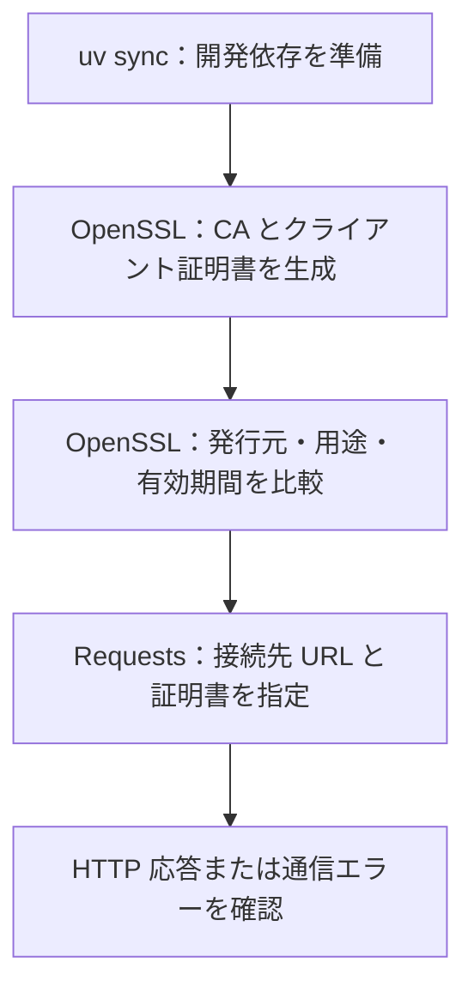
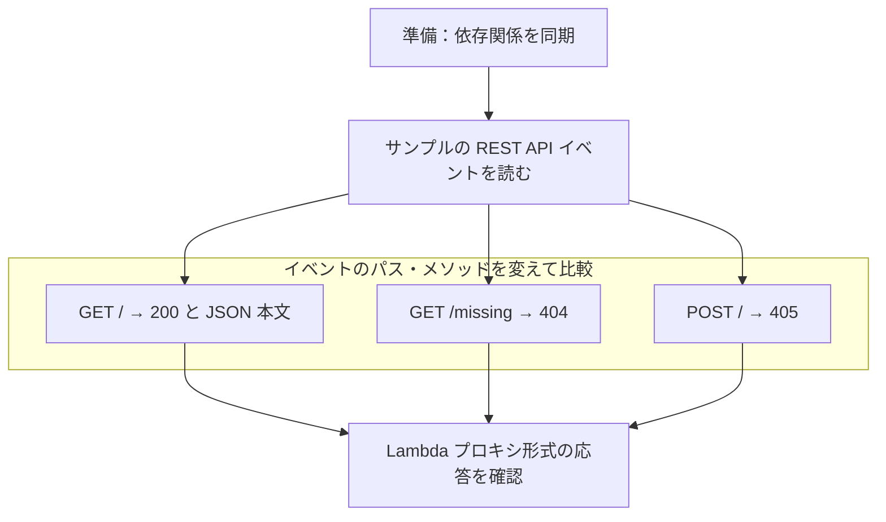
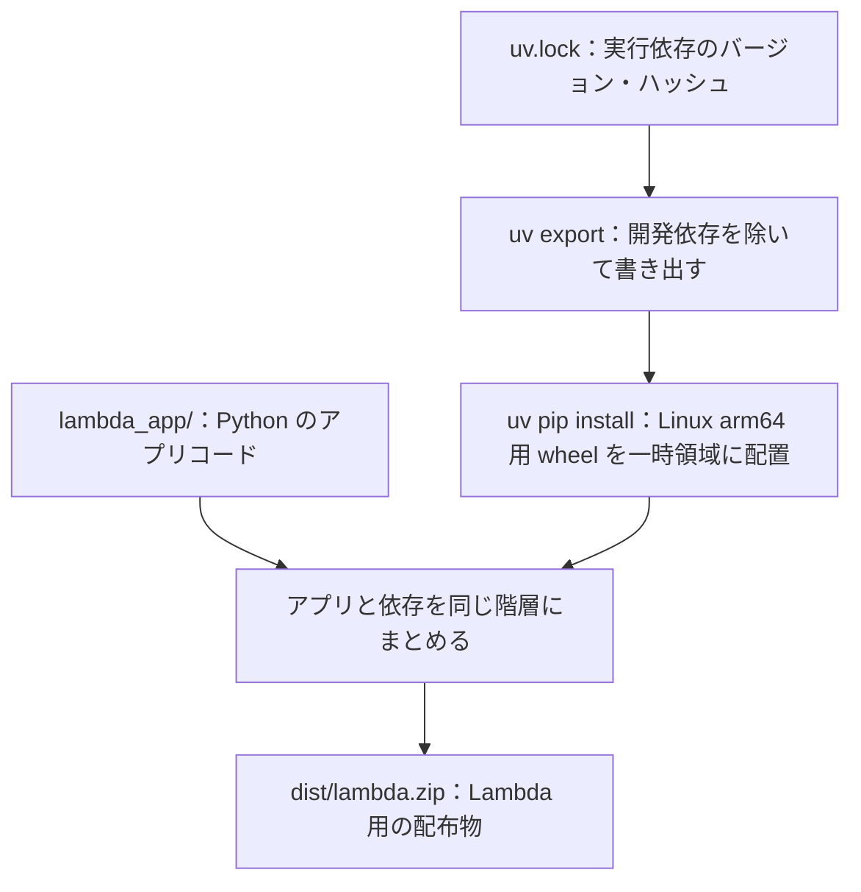

# AWS mTLS

FastAPI + Mangum の Lambda アプリ、配布用 ZIP の作成、AWS 構築用のコードと手順をまとめています。

## 目次

- [目的と概要](#目的と概要)
- [構成](#構成)
- [state 用 S3 の構築](#state-用-s3-の構築)
- [ACM サーバー証明書の申請](#acm-サーバー証明書の申請)
- [API Gateway による mTLS の AWS 基盤](#api-gateway-による-mtls-の-aws-基盤)
- [API の接続確認](#api-の接続確認)
  - [証明書の生成](#証明書の生成)
  - [証明書の検証](#証明書の検証)
  - [Requests クライアント](#requests-クライアント)
- [ローカル実行の準備](#ローカル実行の準備)
- [ローカルでのイベント呼び出し](#ローカルでのイベント呼び出し)
  - [確認の流れ](#確認の流れ)
  - [正常応答](#正常応答)
  - [HTTP エラー応答](#http-エラー応答)
- [Lambda 用 ZIP のビルド](#lambda-用-zip-のビルド)
  - [ビルドの流れと対象](#ビルドの流れと対象)
  - [生成と内容の確認](#生成と内容の確認)
- [自動テストと静的検査](#自動テストと静的検査)

## 目的と概要

- サンプルイベントをハンドラーへ直接渡し、Lambda イベントと HTTP 応答の変換を理解する。
- イベント変換は AWS への接続や HTTP サーバーの起動をせず、ローカルの Python で確認する。
- アプリと実行依存をまとめ、Python 3.14・Linux arm64 用の Lambda 配布 ZIP を作成する。
- state 用 S3 は CloudFormation で作成し、保存先の初期構築をアプリから分離する。
- サーバー証明書は専用の Terraform で申請し、外部 DNS の CNAME で所有確認する。
- API Gateway・mTLS カスタムドメイン・Lambda・IAM・ロググループは Terraform で管理する。
- 検証用 CA 証明書は、state 用とは別の S3 Truststore に Terraform で配置する。
- API の接続確認には Requests を使い、提示するクライアント証明書と接続結果を比較する。

ローカルのイベント呼び出しでは、次の挙動を確認します。

| 検証対象 | 確認する内容 |
| --- | --- |
| イベント変換 | REST API イベント → ASGI → Lambda プロキシ形式の応答 |
| HTTP の処理 | FastAPI の正常応答・404・405 |
| ハンドラーの再利用 | 同じハンドラーの連続呼び出し |

ローカルのイベント呼び出しでは、AWS への接続や TLS・クライアント証明書の検証は行いません。

- [Lambda 用アプリのイベント変換と各要素の役割](../docs/poc/aws-lambda.md)
- [AWS mTLS の構成と認証の流れ](../docs/poc/aws-mtls.md)

## 構成

```text
.
├── lambda_app/
│   ├── __init__.py
│   ├── app.py                # FastAPI：HTTP のパス・メソッドと応答
│   └── handler.py            # Mangum：Lambda イベントと ASGI の変換
├── infra/
│   ├── state/
│   │   ├── template.yaml     # CloudFormation：state 用 S3 とバケットポリシー
│   │   └── README.md         # 作成・設定確認・削除の手順
│   ├── certificate/          # Terraform：ACM 証明書と検証用 CNAME の出力
│   └── api/                  # Terraform：API Gateway・Lambda・IAM・ログ・S3 Truststore
├── scripts/
│   ├── build-lambda.sh       # uv で Linux arm64 向けの依存を取得し ZIP 化
│   ├── generate-client-certs.sh # CA と検証用クライアント証明書を生成
│   ├── client-ca.cnf        # OpenSSL の発行設定とクライアント証明書の用途
│   └── invoke_api.py        # Requests で API を呼び出し、応答・通信エラーを表示
├── certs/generated/         # 証明書・秘密鍵・CSR（Git 管理対象外）
├── tests/
│   ├── events/get-root.json  # 手動確認とテストで共用する REST API イベント
│   ├── test_handler.py
│   └── test_invoke_api.py
├── dist/                     # 生成した lambda.zip（Git 管理対象外）
├── pyproject.toml
└── uv.lock
```

- Lambda の入口：`lambda_app.handler.handler(event, context)`。
- `local-mtls/` から独立した uv プロジェクト。既存アプリの import は不要。

## state 用 S3 の構築

[state 基盤の手順](infra/state/README.md) に、CloudFormation による作成、暗号化・公開遮断などの設定確認、スタックの削除方法を記載しています。この操作には AWS CLI と AWS 認証が必要です。

## ACM サーバー証明書の申請

[証明書の手順](infra/certificate/README.md) に、Terraform の S3 backend 設定、証明書の申請、外部 DNS への CNAME 登録、発行確認と削除を記載しています。AWS CLI・Terraform・AWS 認証を使用します。

## API Gateway による mTLS の AWS 基盤

API Gateway・mTLS カスタムドメイン・Lambda・S3 Truststore の構築、DNS 登録、設定確認、削除は [AWS 基盤の手順](infra/api/README.md) を参照してください。

## API の接続確認

接続先の HTTPS API に対し、証明書の提示有無や発行元を変えて接続結果を比較します。以下は `aws-mtls/` で実行します。



### 証明書の生成

OpenSSL 3 以降と開発用依存関係を用意します。生成処理は AWS 認証やネットワーク接続を必要としません。

```sh
uv sync --locked --dev --python 3.14
sh scripts/generate-client-certs.sh
```

| 生成ファイル | 用途 |
| --- | --- |
| `certs/generated/ca.crt` | 正常・期限切れ証明書の発行元 CA。Truststore に配置する証明書 |
| `certs/generated/ca.key` | CA の秘密鍵。ローカルに保持 |
| `certs/generated/client.crt`・`client.key` | 正常なクライアントの証明書・秘密鍵 |
| `certs/generated/untrusted/` | 別の CA と、その CA が発行したクライアント証明書・秘密鍵 |
| `certs/generated/expired/` | 正常系と同じ CA が発行した、有効期間が過去のクライアント証明書・秘密鍵 |

- クライアント証明書には、TLS 接続時にクライアントが自分を証明するために使用できるという用途情報を設定します。OpenSSL では `extendedKeyUsage = clientAuth` と指定します。`clientAuth` は、この用途を表す OpenSSL の定義済みの名前です。
- 秘密鍵の権限は所有者だけが読み書きできる `0600`。証明書・秘密鍵・CSR は Git 管理対象外です。
- 既存の生成先がある場合は上書きせず終了します。別の一式が必要な場合は、`sh scripts/generate-client-certs.sh certs/generated/another` のように未使用の生成先を指定します。
- [client-ca.cnf](scripts/client-ca.cnf) は、発行記録と連番の保存先、証明書の用途を指定します。発行記録は生成時の一時領域に置き、終了時に削除します。

### 証明書の検証

正常な証明書と、不正な条件の証明書を同じ CA で検証します。

```sh
openssl verify -purpose sslclient -CAfile certs/generated/ca.crt certs/generated/client.crt
openssl verify -purpose sslclient -CAfile certs/generated/ca.crt certs/generated/untrusted/client.crt
openssl verify -purpose sslclient -CAfile certs/generated/ca.crt certs/generated/expired/client.crt
```

| 証明書 | 期待する結果 |
| --- | --- |
| 正常 | `OK` |
| 非信頼 CA | `error 20`：`unable to get local issuer certificate` |
| 期限切れ | `error 10`：`certificate has expired` |

用途と有効期間は、次のコマンドで確認できます。期限切れ証明書は、2020年1月1日〜2日を有効期間として発行しています。

```sh
openssl x509 -in certs/generated/client.crt -noout -dates -ext extendedKeyUsage
openssl x509 -in certs/generated/expired/client.crt -noout -dates
```

### Requests クライアント

接続先には、実際に用意した HTTPS API の URL を指定します。mTLS の場合は、その API が信頼する CA で発行したクライアント証明書を使います。

```sh
uv run --locked python scripts/invoke_api.py \
  --url https://mtls-poc.example.com/ \
  --certfile certs/generated/client.crt \
  --keyfile certs/generated/client.key
```

- `--certfile` と `--keyfile` を両方省略すると、証明書を提示せずに接続します。片方だけの指定は引数エラーです。
- `--method POST` を指定すると、同じクライアントで POST を試せます。
- サーバー証明書は Requests 標準の公開 CA で検証します。ローカルで生成した `ca.crt` はクライアントの発行元であり、このサーバー検証には使いません。
- リダイレクトは追跡せず、指定した接続先からの結果を表示します。

| 結果 | 表示と終了コード |
| --- | --- |
| HTTP 2xx | ステータス・本文と、応答に含まれる Content-Type・リクエスト ID ヘッダーを表示。終了コード `0` |
| HTTP 403・404・405 など | 同じ形式で HTTP 応答を表示。2xx 以外は終了コード `1` |
| TLS・接続・タイムアウトのエラー | 標準エラー出力に例外の種類と詳細を表示。終了コード `2` |

HTTP エラーは、HTTP 応答を受け取れない通信エラーと区別します。拒否理由はステータスや例外名だけで断定せず、入力した証明書の条件とサーバー側のログを照合します。

## ローカル実行の準備

- Python 3.14
- [uv](https://docs.astral.sh/uv/)

以降は `aws-mtls/` で実行します。

```sh
uv sync --locked --dev --python 3.14
```

- 実行依存：FastAPI・Mangum。
- 開発依存：pytest・Ruff・cfn-lint（CloudFormation の静的検査）・Requests（API の接続確認）。Requests は Lambda 用 ZIP には含めません。
- ローカルでハンドラーを直接呼び出すため、Uvicorn・Docker・AWS 認証情報は不要。

## ローカルでのイベント呼び出し

### 確認の流れ



- HTTP サーバーへの接続ではなく、Python 関数としてイベントを渡す。
- サンプルのホスト・識別子・IP は架空の値。
- `context` はこのアプリで参照しないため、ローカル確認では `None` を渡す。

### 正常応答

テストと同じ JSON ファイルを読み、実際の Mangum ハンドラーを呼び出します。

```sh
uv run --locked python - <<'PY'
import json
from pathlib import Path

from lambda_app.handler import handler

event = json.loads(Path("tests/events/get-root.json").read_text(encoding="utf-8"))
response = handler(event, None)
print(json.dumps(response, ensure_ascii=False, indent=2))
PY
```

| 応答フィールド | 期待する値・意味 |
| --- | --- |
| `statusCode` | `200` |
| `headers.content-type` | `application/json` |
| `body` | JSON 文字列 `{"message":"Hello from Lambda"}` |
| `isBase64Encoded` | `false`：本文は Base64 エンコードされていない |

- 外側の応答は Lambda プロキシ形式の辞書。
- `body` は文字列。JSON の値として読む場合は `json.loads(response["body"])` を使う。

### HTTP エラー応答

同じハンドラーに、パスとメソッドを変更したイベントを渡します。

```sh
uv run --locked python - <<'PY'
import json
from pathlib import Path

from lambda_app.handler import handler

for method, path in [("GET", "/missing"), ("POST", "/")]:
    event = json.loads(Path("tests/events/get-root.json").read_text(encoding="utf-8"))
    event["httpMethod"] = method
    event["path"] = path
    event["resource"] = "/{proxy+}" if path != "/" else "/"
    event["pathParameters"] = {"proxy": "missing"} if path != "/" else None
    event["requestContext"].update(
        httpMethod=method, path=f"/poc{path}", resourcePath=event["resource"]
    )
    response = handler(event, None)
    print(method, path, response["statusCode"], json.loads(response["body"]))
PY
```

| イベント | ステータス | 本文を JSON として読んだ値 |
| --- | --- | --- |
| `GET /missing` | `404` | `{"detail":"Not Found"}` |
| `POST /` | `405` | `{"detail":"Method Not Allowed"}` |

- FastAPI が HTTP エラーを生成し、Mangum が Lambda プロキシ形式に変換。
- ここでの 404・405 は HTTP の処理結果。証明書検証による接続拒否とは別のもの。

## Lambda 用 ZIP のビルド

### ビルドの流れと対象



| 項目 | 対象・動作 |
| --- | --- |
| 実行環境 | Lambda の Python 3.14・arm64 |
| wheel の対象 | `aarch64-manylinux2014`。glibc 2.17 以降に対応する Linux arm64 |
| 依存の取得 | `uv.lock` の実行依存をハッシュ検証して取得。Mac の `.venv` はコピーしない |
| アプリ | `lambda_app/` の `.py` ファイル |
| 除外 | 開発依存・テスト・インフラ・キャッシュ・依存パッケージの CLI |
| 出力 | `dist/lambda.zip`。ファイルの順序・日時・権限を揃え、同じビルド環境・内容なら同じハッシュになる |
| 失敗時 | 対応 wheel がなければ停止。既存の ZIP を維持し、一時領域を削除 |

ZIP のルートに `lambda_app/` と `fastapi/`・`mangum/` などの依存が並びます。Lambda のハンドラー名は `lambda_app.handler.handler` です。

### 生成と内容の確認

`aws-mtls/` で実行します。uv と `zip`・`unzip` を用意してください。依存の取得にはネットワーク接続が必要です。Docker・AWS 認証は不要です。

```sh
sh scripts/build-lambda.sh
unzip -tq dist/lambda.zip
```

アプリとネイティブライブラリの格納位置を確認します。

```sh
uv run --locked python - <<'PY'
from zipfile import ZipFile

with ZipFile("dist/lambda.zip") as archive:
    for name in archive.namelist():
        if name.startswith("lambda_app/") or name.endswith(".so"):
            print(name)
PY
```

| ZIP 内のパス | 内容 |
| --- | --- |
| `lambda_app/__init__.py`・`app.py`・`handler.py` | アプリと Lambda の入口 |
| `pydantic_core/…aarch64-linux-gnu.so` | Pydantic が使う Linux arm64 用のネイティブライブラリ |

- Mac 上でのイベント呼び出しは、前述の `.venv` を使う手順で確認します。
- この ZIP は Linux 向けです。内容の検査と、Lambda 上での起動確認は別の検証になります。
- 配布方式の判断は [ZIP 配布の ADR](../docs/adr/0001-lambda-zip-deployment.md)、作成方法の仕様は [AWS の Python ZIP](https://docs.aws.amazon.com/lambda/latest/dg/python-package.html) と [uv の Lambda ガイド](https://docs.astral.sh/uv/guides/integration/aws-lambda/) を参照してください。

## 自動テストと静的検査

```sh
uv run --locked pytest
uv run --locked ruff format --check .
uv run --locked ruff check .
uv run --locked cfn-lint infra/state/template.yaml
```

| ケース | 確認する内容 |
| --- | --- |
| `GET /` | ステータス・Content-Type・JSON 本文・Base64 フラグ |
| 未定義のパス | `404` と JSON エラー本文 |
| `POST /` | `405` と JSON エラー本文・許可メソッド |
| 同じハンドラーを連続呼び出し | どちらも正常応答を返す |

- イベント変換をモックせず、実際の Mangum を通して検証。
- Requests クライアントは通信を置き換え、引数・証明書検証の設定・出力・終了コードを検証。実際の TLS 認証は接続先の API で確認。
- ZIP は CI で実際にビルドし、`unzip -tq` でアーカイブの整合性を確認。
- CloudFormation は cfn-lint で構造・プロパティ・値などを静的検査。作成後の設定確認は [state 基盤の手順](infra/state/README.md#設定の確認) を参照。
- 整形する場合は `uv run --locked ruff format .` を実行。
