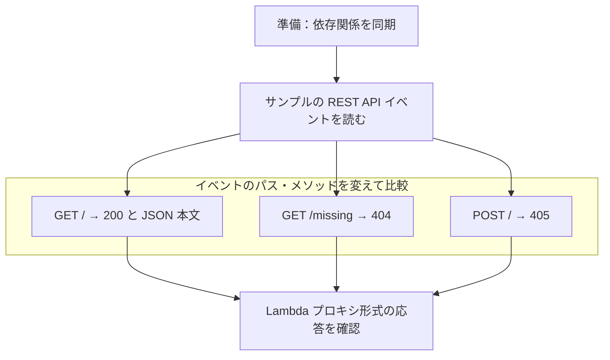

# AWS 用 Lambda アプリと state 基盤

API Gateway REST API の Lambda イベントを、Mangum 経由で FastAPI に渡す学習例です。Terraform state の保存先を作る CloudFormation テンプレートも含みます。

## 目次

- [目的と概要](#目的と概要)
- [構成](#構成)
- [state 用 S3 の構築](#state-用-s3-の構築)
- [実行環境と準備](#実行環境と準備)
- [イベントからの呼び出し](#イベントからの呼び出し)
  - [確認の流れ](#確認の流れ)
  - [正常応答](#正常応答)
  - [HTTP エラー応答](#http-エラー応答)
- [自動テストと静的検査](#自動テストと静的検査)

## 目的と概要

- サンプルイベントをハンドラーへ直接渡し、Lambda イベントと HTTP 応答の変換を理解する。
- AWS への接続や HTTP サーバーの起動をせず、ローカルの Python で実行する。
- state 用 S3 は CloudFormation で作成し、保存先の初期構築をアプリから分離する。

| 検証対象 | 確認する内容 |
| --- | --- |
| イベント変換 | REST API イベント → ASGI → Lambda プロキシ形式の応答 |
| HTTP の処理 | FastAPI の正常応答・404・405 |
| ハンドラーの再利用 | 同じハンドラーの連続呼び出し |

この実行方法では、実際の API Gateway と Lambda の通信や、TLS・クライアント証明書の検証は行いません。

- [Lambda 用アプリのイベント変換と各要素の役割](../docs/poc/aws-lambda.md)
- [AWS mTLS の構成と認証の流れ](../docs/poc/aws-mtls.md)

## 構成

```text
.
├── lambda_app/
│   ├── __init__.py
│   ├── app.py                # FastAPI：HTTP のパス・メソッドと応答
│   └── handler.py            # Mangum：Lambda イベントと ASGI の変換
├── infra/
│   └── state/
│       ├── template.yaml     # CloudFormation：state 用 S3 とバケットポリシー
│       └── README.md         # 作成・設定確認・削除の手順
├── tests/
│   ├── events/get-root.json  # 手動確認とテストで共用する REST API イベント
│   └── test_handler.py
├── pyproject.toml
└── uv.lock
```

- Lambda の入口：`lambda_app.handler.handler(event, context)`。
- `local-mtls/` から独立した uv プロジェクト。既存アプリの import は不要。

## state 用 S3 の構築

[state 基盤の手順](infra/state/README.md) に、CloudFormation による作成、暗号化・公開遮断などの設定確認、スタックの削除方法を記載しています。この操作には AWS CLI と AWS 認証が必要です。

## 実行環境と準備

- Python 3.13
- [uv](https://docs.astral.sh/uv/)

以降は `aws-mtls/` で実行します。

```sh
uv sync --locked --dev --python 3.13
```

- 実行依存：FastAPI・Mangum。
- 開発依存：pytest・Ruff・cfn-lint（CloudFormation の静的検査）。
- ハンドラーを直接呼び出すため、Uvicorn・Docker・AWS 認証情報は不要。

## イベントからの呼び出し

### 確認の流れ



- HTTP サーバーへの接続ではなく、Python 関数としてイベントを渡す。
- サンプルのホスト・識別子・IP は架空の値。
- `context` はこのアプリで参照しないため、ローカル確認では `None` を渡す。

### 正常応答

テストと同じ JSON ファイルを読み、実際の Mangum ハンドラーを呼び出します。

```sh
uv run --locked python - <<'PY'
import json
from pathlib import Path

from lambda_app.handler import handler

event = json.loads(Path("tests/events/get-root.json").read_text(encoding="utf-8"))
response = handler(event, None)
print(json.dumps(response, ensure_ascii=False, indent=2))
PY
```

| 応答フィールド | 期待する値・意味 |
| --- | --- |
| `statusCode` | `200` |
| `headers.content-type` | `application/json` |
| `body` | JSON 文字列 `{"message":"Hello from Lambda"}` |
| `isBase64Encoded` | `false`：本文は Base64 エンコードされていない |

- 外側の応答は Lambda プロキシ形式の辞書。
- `body` は文字列。JSON の値として読む場合は `json.loads(response["body"])` を使う。

### HTTP エラー応答

同じハンドラーに、パスとメソッドを変更したイベントを渡します。

```sh
uv run --locked python - <<'PY'
import json
from pathlib import Path

from lambda_app.handler import handler

for method, path in [("GET", "/missing"), ("POST", "/")]:
    event = json.loads(Path("tests/events/get-root.json").read_text(encoding="utf-8"))
    event["httpMethod"] = method
    event["path"] = path
    event["resource"] = "/{proxy+}" if path != "/" else "/"
    event["pathParameters"] = {"proxy": "missing"} if path != "/" else None
    event["requestContext"].update(
        httpMethod=method, path=f"/poc{path}", resourcePath=event["resource"]
    )
    response = handler(event, None)
    print(method, path, response["statusCode"], json.loads(response["body"]))
PY
```

| イベント | ステータス | 本文を JSON として読んだ値 |
| --- | --- | --- |
| `GET /missing` | `404` | `{"detail":"Not Found"}` |
| `POST /` | `405` | `{"detail":"Method Not Allowed"}` |

- FastAPI が HTTP エラーを生成し、Mangum が Lambda プロキシ形式に変換。
- ここでの 404・405 は HTTP の処理結果。証明書検証による接続拒否とは別のもの。

## 自動テストと静的検査

```sh
uv run --locked pytest
uv run --locked ruff format --check .
uv run --locked ruff check .
uv run --locked cfn-lint infra/state/template.yaml
```

| ケース | 確認する内容 |
| --- | --- |
| `GET /` | ステータス・Content-Type・JSON 本文・Base64 フラグ |
| 未定義のパス | `404` と JSON エラー本文 |
| `POST /` | `405` と JSON エラー本文・許可メソッド |
| 同じハンドラーを連続呼び出し | どちらも正常応答を返す |

- イベント変換をモックせず、実際の Mangum を通して検証。
- CloudFormation は cfn-lint で構造・プロパティ・値などを静的検査。作成後の設定確認は [state 基盤の手順](infra/state/README.md#設定の確認) を参照。
- 整形する場合は `uv run --locked ruff format .` を実行。
