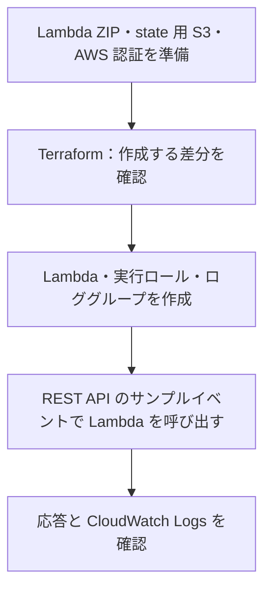

# Lambda の AWS 実行基盤

FastAPI + Mangum のアプリを Lambda へ ZIP 形式で配置し、実行ロールと CloudWatch Logs を Terraform で管理します。

## 目次

- [構成と確認の流れ](#構成と確認の流れ)
- [準備](#準備)
- [作成](#作成)
- [呼び出しとログの確認](#呼び出しとログの確認)
- [削除](#削除)
- [ローカルの検証](#ローカルの検証)

## 構成と確認の流れ



| 対象 | 設定・役割 |
| --- | --- |
| Lambda | `mtls-poc`、Python 3.14、arm64、メモリ256 MB、タイムアウト10秒 |
| 配布物 | `../../dist/lambda.zip`。内容のハッシュで ZIP の更新を検出 |
| ハンドラー | `lambda_app.handler.handler` |
| 実行ロール | Lambda から対象ロググループへの書き込みを許可 |
| ロググループ | `/aws/lambda/mtls-poc`、保持期間7日。Terraform が作成・削除 |
| state | 既存の state 用 S3 の `api/terraform.tfstate`。証明書用とは別のキー |

## 準備

- Terraform 1.10 以上、2.0 未満、AWS CLI と AWS 認証を用意します。
- [state 用 S3](../state/README.md) を作成し、S3・Lambda・IAM・CloudWatch Logs を操作できる権限を用意します。
- IAM ロールとポリシーの作成、および Lambda に実行ロールを渡す `iam:PassRole` が必要です。
- 動作確認には `lambda:InvokeFunction` と、CloudWatch Logs の読み取り権限も必要です。

`aws-mtls/` で ZIP を生成してから、Terraform のディレクトリに移動します。

```sh
sh scripts/build-lambda.sh
cd infra/api
```

使用する AWS リージョンと state 用 S3 の情報を用意し、backend 設定を生成します。state 基盤が別リージョンにある場合は、CloudFormation のコマンドにその `--region` を指定します。

```sh
export AWS_REGION="$(aws configure get region)"
test -n "$AWS_REGION"
aws sts get-caller-identity

STATE_BUCKET=$(aws cloudformation describe-stacks \
  --stack-name mtls-poc-state \
  --query 'Stacks[0].Outputs[?OutputKey==`StateBucketName`].OutputValue | [0]' \
  --output text)
STATE_REGION=$(aws cloudformation describe-stacks \
  --stack-name mtls-poc-state \
  --query 'Stacks[0].Outputs[?OutputKey==`StateBucketRegion`].OutputValue | [0]' \
  --output text)

umask 077
cat > backend.hcl <<EOF
bucket = "$STATE_BUCKET"
region = "$STATE_REGION"
key    = "api/terraform.tfstate"
EOF
```

## 作成

以下は `aws-mtls/infra/api/` で実行します。

```sh
terraform init -backend-config=backend.hcl
terraform fmt -check -recursive
terraform validate
terraform plan -out=api.tfplan
```

Lambda、実行ロール、ログ用ポリシー、ロググループの差分を確認して適用します。

```sh
terraform apply api.tfplan
```

アプリを変更した場合は ZIP を再生成してから `terraform plan` を実行します。生成物のハッシュが変わると Lambda のコードが更新されます。

## 呼び出しとログの確認

REST API のサンプルイベントを Lambda に直接渡します。

```sh
LAMBDA_RESPONSE=$(mktemp)
aws lambda invoke \
  --function-name "$(terraform output -raw lambda_function_name)" \
  --payload fileb://../../tests/events/get-root.json \
  "$LAMBDA_RESPONSE"
cat "$LAMBDA_RESPONSE"
rm "$LAMBDA_RESPONSE"
```

CLI に表示される呼び出し結果と、ファイルに保存されるアプリの応答を確認します。

| 確認対象 | 期待する値・意味 |
| --- | --- |
| CLI の `StatusCode` | `200`。Lambda の同期呼び出しが成功 |
| CLI の `FunctionError` | 項目がない。関数実行でエラーが発生していない |
| 応答の `statusCode` | `200`。FastAPI の正常応答 |
| 応答の `body` | JSON 文字列 `{"message":"Hello from Lambda"}` |

`StatusCode = 200` だけでは、関数実行やアプリの処理が成功したとは判断できません。呼び出し結果の仕様は [AWS CLI の invoke](https://docs.aws.amazon.com/cli/latest/reference/lambda/invoke.html) を参照してください。

```sh
aws logs tail /aws/lambda/mtls-poc --since 10m
```

Lambda の実行ログを確認します。API Gateway を経由する mTLS 通信は、この直接呼び出しでは検証しません。

## 削除

```sh
terraform plan -destroy
terraform destroy
terraform state list
```

管理対象の削除とロググループの消去を確認します。state 用 S3 の整理は [state 基盤の削除手順](../state/README.md#削除) を参照してください。

## ローカルの検証

実環境の backend で初期化したディレクトリとは別のコピーで実行します。AWS 認証と実際の ZIP は不要です。初期化時には Terraform Registry への接続が必要です。

```sh
terraform init -backend=false -input=false -lockfile=readonly
terraform fmt -check -recursive
terraform validate
terraform test
```

テストはモックとテスト用のファイルを使い、実行設定・ロールの信頼関係・ログ権限・配布物のハッシュを確認します。AWS での実際の起動とログ出力は、上記の手順で確認します。

プロバイダーの更新後は、開発環境の Mac arm64 と CI の Linux amd64 のハッシュを記録します。

```sh
terraform providers lock -platform=darwin_arm64 -platform=linux_amd64
```
