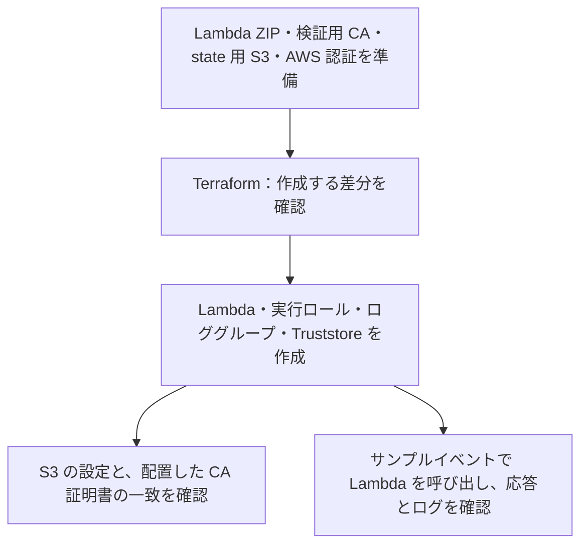

# Lambda と Truststore の AWS 基盤

FastAPI + Mangum のアプリを Lambda へ ZIP 形式で配置し、実行ロール・CloudWatch Logs・クライアント証明書の検証用 CA を保存する S3 Truststore を Terraform で管理します。

## 目次

- [構成と確認の流れ](#構成と確認の流れ)
- [準備](#準備)
- [作成](#作成)
- [Truststore の設定と内容の確認](#truststore-の設定と内容の確認)
- [呼び出しとログの確認](#呼び出しとログの確認)
- [削除](#削除)
- [ローカルの検証](#ローカルの検証)

## 構成と確認の流れ



| 対象 | 設定・役割 |
| --- | --- |
| Lambda | `mtls-poc`、Python 3.14、arm64、メモリ256 MB、タイムアウト10秒 |
| 配布物 | `../../dist/lambda.zip`。内容のハッシュで ZIP の更新を検出 |
| ハンドラー | `lambda_app.handler.handler` |
| 実行ロール | Lambda から対象ロググループへの書き込みを許可 |
| ロググループ | `/aws/lambda/mtls-poc`、保持期間7日。Terraform が作成・削除 |
| Truststore | state 用とは別の S3 バケットに、CA 証明書を `truststore.pem` として保存 |
| state | 既存の state 用 S3 の `api/terraform.tfstate`。証明書用とは別のキー |

Truststore のバケット名には `mtls-poc-truststore-` に一意な接尾辞を付けます。名前・S3 URI・オブジェクトのバージョンは Terraform の出力で取得します。

| Truststore の設定 | 役割 |
| --- | --- |
| Block Public Access | 公開アクセスを遮断する4設定を有効化 |
| ACL | `BucketOwnerEnforced` で無効化 |
| 保存時の暗号化 | SSE-S3（`AES256`）を使用 |
| 通信 | バケットとオブジェクトへの HTTP アクセスを拒否 |
| バージョニング | CA 証明書の更新前後を識別し、参照する版を指定可能にする |
| 削除 | `force_destroy = true`。バケット削除時に過去バージョンも削除 |

## 準備

- Terraform 1.10 以上、2.0 未満、AWS CLI と AWS 認証を用意します。
- [state 用 S3](../state/README.md) を作成し、S3・Lambda・IAM・CloudWatch Logs を操作できる権限を用意します。
- IAM ロールとポリシーの作成、および Lambda に実行ロールを渡す `iam:PassRole` が必要です。
- 動作確認には `lambda:InvokeFunction` と、CloudWatch Logs の読み取り権限も必要です。
- [クライアント証明書の生成手順](../../README.md#証明書の生成) で、検証用 CA 証明書を用意します。Truststore には CA 証明書だけを指定します。

| 入力変数 | 既定値（このディレクトリからの相対パス） |
| --- | --- |
| `lambda_package_path` | `../../dist/lambda.zip` |
| `truststore_path` | `../../certs/generated/ca.crt` |

別の CA を使う場合は、Git 管理外の `terraform.tfvars` で `truststore_path` にその PEM ファイルを指定します。

`aws-mtls/` で ZIP を生成してから、Terraform のディレクトリに移動します。

```sh
sh scripts/build-lambda.sh
cd infra/api
```

使用する AWS リージョンと state 用 S3 の情報を用意し、backend 設定を生成します。state 基盤が別リージョンにある場合は、CloudFormation のコマンドにその `--region` を指定します。

```sh
export AWS_REGION="$(aws configure get region)"
test -n "$AWS_REGION"
aws sts get-caller-identity

STATE_BUCKET=$(aws cloudformation describe-stacks \
  --stack-name mtls-poc-state \
  --query 'Stacks[0].Outputs[?OutputKey==`StateBucketName`].OutputValue | [0]' \
  --output text)
STATE_REGION=$(aws cloudformation describe-stacks \
  --stack-name mtls-poc-state \
  --query 'Stacks[0].Outputs[?OutputKey==`StateBucketRegion`].OutputValue | [0]' \
  --output text)

umask 077
cat > backend.hcl <<EOF
bucket = "$STATE_BUCKET"
region = "$STATE_REGION"
key    = "api/terraform.tfstate"
EOF
```

## 作成

以下は `aws-mtls/infra/api/` で実行します。

```sh
terraform init -backend-config=backend.hcl
terraform fmt -check -recursive
terraform validate
terraform plan -out=api.tfplan
```

Lambda・実行ロール・ログ用ポリシー・ロググループと、Truststore の S3 バケット・設定・オブジェクトの差分を確認して適用します。

```sh
terraform apply api.tfplan
```

アプリを変更した場合は ZIP を再生成してから `terraform plan` を実行します。生成物のハッシュが変わると Lambda のコードが更新されます。Truststore も CA ファイルの内容のハッシュで変更を検出し、更新時に新しいオブジェクトバージョンを作成します。

| 出力 | 用途 |
| --- | --- |
| `lambda_function_name` | Lambda の直接呼び出し |
| `lambda_function_arn` | Lambda を識別する ARN |
| `truststore_bucket_name` | S3 の設定と配置内容の確認 |
| `truststore_uri` | mTLS で参照する Truststore の S3 URI |
| `truststore_version_id` | 参照する CA 証明書のオブジェクトバージョン |

## Truststore の設定と内容の確認

Terraform の出力から対象を取得し、S3 の設定を確認します。

```sh
TRUSTSTORE_BUCKET=$(terraform output -raw truststore_bucket_name)
TRUSTSTORE_VERSION=$(terraform output -raw truststore_version_id)

aws s3api get-public-access-block --bucket "$TRUSTSTORE_BUCKET"
aws s3api get-bucket-ownership-controls --bucket "$TRUSTSTORE_BUCKET"
aws s3api get-bucket-encryption --bucket "$TRUSTSTORE_BUCKET"
aws s3api get-bucket-versioning --bucket "$TRUSTSTORE_BUCKET"
aws s3api get-bucket-policy --bucket "$TRUSTSTORE_BUCKET" --query Policy --output text
aws s3api head-object \
  --bucket "$TRUSTSTORE_BUCKET" --key truststore.pem \
  --version-id "$TRUSTSTORE_VERSION" \
  --query '{VersionId:VersionId,Encryption:ServerSideEncryption}'
```

各設定が「構成と確認の流れ」の表と一致し、オブジェクトのバージョンが出力値と一致することを確認します。

配置したファイルを取得し、元の CA 証明書と比較します。以下は既定の `truststore_path` を使う場合の例です。入力を変更した場合は、`cmp` の比較元も同じファイルに変更します。

```sh
TRUSTSTORE_COPY=$(mktemp)
aws s3api get-object \
  --bucket "$TRUSTSTORE_BUCKET" --key truststore.pem \
  --version-id "$TRUSTSTORE_VERSION" "$TRUSTSTORE_COPY"
cmp ../../certs/generated/ca.crt "$TRUSTSTORE_COPY"
openssl x509 -in "$TRUSTSTORE_COPY" -noout -subject -issuer
rm "$TRUSTSTORE_COPY"
```

`cmp` が出力なし・終了コード `0` で終了すれば内容は一致しています。Truststore の証明書チェーンとバージョン指定の仕様は [API Gateway の mTLS](https://docs.aws.amazon.com/apigateway/latest/developerguide/rest-api-mutual-tls.html) を参照してください。

## 呼び出しとログの確認

REST API のサンプルイベントを Lambda に直接渡します。

```sh
LAMBDA_RESPONSE=$(mktemp)
aws lambda invoke \
  --function-name "$(terraform output -raw lambda_function_name)" \
  --payload fileb://../../tests/events/get-root.json \
  "$LAMBDA_RESPONSE"
cat "$LAMBDA_RESPONSE"
rm "$LAMBDA_RESPONSE"
```

CLI に表示される呼び出し結果と、ファイルに保存されるアプリの応答を確認します。

| 確認対象 | 期待する値・意味 |
| --- | --- |
| CLI の `StatusCode` | `200`。Lambda の同期呼び出しが成功 |
| CLI の `FunctionError` | 項目がない。関数実行でエラーが発生していない |
| 応答の `statusCode` | `200`。FastAPI の正常応答 |
| 応答の `body` | JSON 文字列 `{"message":"Hello from Lambda"}` |

`StatusCode = 200` だけでは、関数実行やアプリの処理が成功したとは判断できません。呼び出し結果の仕様は [AWS CLI の invoke](https://docs.aws.amazon.com/cli/latest/reference/lambda/invoke.html) を参照してください。

```sh
aws logs tail /aws/lambda/mtls-poc --since 10m
```

Lambda の実行ログを確認します。API Gateway を経由する mTLS 通信は、この直接呼び出しでは検証しません。

## 削除

```sh
terraform plan -destroy
terraform destroy
terraform state list
```

Lambda・実行ロール・ロググループ・Truststore の削除と、state が空になったことを確認します。Truststore バケットの `force_destroy` により、過去バージョンや削除マーカーを含む全オブジェクトも削除されます。この削除は取り消せません。仕様は [Terraform の S3 バケット](https://registry.terraform.io/providers/hashicorp/aws/latest/docs/resources/s3_bucket) を参照してください。

state 用 S3 は別の CloudFormation スタックで管理しています。整理する手順は [state 基盤の削除](../state/README.md#削除) を参照してください。

## ローカルの検証

実環境の backend で初期化したディレクトリとは別のコピーで実行します。AWS 認証と実際の ZIP は不要です。初期化時には Terraform Registry への接続が必要です。

```sh
terraform init -backend=false -input=false -lockfile=readonly
terraform fmt -check -recursive
terraform validate
terraform test
```

テストはモックとテスト用のファイルを使い、Lambda の実行設定・ロール・ログ権限と、Truststore の公開遮断・暗号化・バージョニング・HTTP 拒否・配置と参照情報を確認します。AWS での実際の起動・ログ出力・S3 の設定と配置内容は、上記の手順で確認します。

プロバイダーの更新後は、開発環境の Mac arm64 と CI の Linux amd64 のハッシュを記録します。

```sh
terraform providers lock -platform=darwin_arm64 -platform=linux_amd64
```
