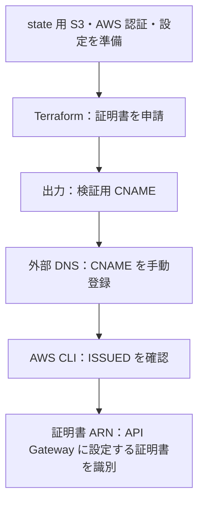

# ACM サーバー証明書

API Gateway の Regional カスタムドメインで使う、エクスポート不可の ACM パブリック証明書を申請します。ドメインの所有確認には、外部 DNS へ手動登録する CNAME を使います。

## 目次

- [構成と確認の流れ](#構成と確認の流れ)
- [準備](#準備)
- [申請](#申請)
- [DNS 登録と発行確認](#dns-登録と発行確認)
  - [検証用 CNAME の登録](#検証用-cname-の登録)
  - [発行状況の確認](#発行状況の確認)
- [削除](#削除)
- [ローカルの検証](#ローカルの検証)

## 構成と確認の流れ



| 対象 | 設定・役割 |
| --- | --- |
| 証明書 | ACM パブリック証明書、RSA 2048 bit、エクスポート不可 |
| リージョン | API Gateway の Regional カスタムドメインと同じリージョン |
| DNS | DNS 管理サービスで検証用 CNAME を登録 |
| state | 既存の state 用 S3 に `certificate/terraform.tfstate` として保存 |
| ロック | S3 の `.tflock` で同時更新を防ぐ |

- Terraform の apply は証明書の申請まで。DNS 登録や発行完了を待たずに終了します。
- サーバーの秘密鍵は ACM が管理し、ローカルへ配布しません。

## 準備

- Terraform：1.10 以上、2.0 未満。S3 ロックには 1.10 以降が必要です。CI は最新の安定版を使用します。
- AWS CLI と、SSO などで認証済みの `AWS_PROFILE` を用意します。
- [state 用 S3](../state/README.md) を作成し、ACM・S3 を操作できる IAM 権限を用意します。
- state の読み書きに加え、ロックファイルには `s3:GetObject`・`s3:PutObject`・`s3:DeleteObject` が必要です。

以下は `aws-mtls/infra/certificate/` で実行します。

使用するプロファイルのリージョンを選択します。API Gateway もこのリージョンに作成します。

```sh
export AWS_REGION="$(aws configure get region)"
test -n "$AWS_REGION"
aws sts get-caller-identity
```

state 基盤の出力を取得し、backend 設定を生成します。state 基盤が別リージョンにある場合は、以下の CloudFormation コマンドにその `--region` を指定してください。

```sh
STATE_BUCKET=$(aws cloudformation describe-stacks \
  --stack-name mtls-poc-state \
  --query 'Stacks[0].Outputs[?OutputKey==`StateBucketName`].OutputValue | [0]' \
  --output text)
STATE_REGION=$(aws cloudformation describe-stacks \
  --stack-name mtls-poc-state \
  --query 'Stacks[0].Outputs[?OutputKey==`StateBucketRegion`].OutputValue | [0]' \
  --output text)

umask 077
cat > backend.hcl <<EOF
bucket = "$STATE_BUCKET"
region = "$STATE_REGION"
key    = "certificate/terraform.tfstate"
EOF
```

入力ファイルをコピーし、`domain_name` を証明書を発行するドメインへ変更します。

```sh
cp terraform.tfvars.example terraform.tfvars
```

- 認証は環境変数・AWS の認証設定から読み込みます。
- `backend.hcl`・`terraform.tfvars`・state・保存した plan は Git 管理対象外です。プロバイダーのバージョンとハッシュを固定する `.terraform.lock.hcl` は管理対象です。

## 申請

```sh
terraform init -backend-config=backend.hcl
terraform fmt -check
terraform validate
terraform plan -out=certificate.tfplan
```

差分で `aws_acm_certificate.server` の作成、対象ドメイン、`validation_method = "DNS"`、`options.export = "DISABLED"` を確認して適用します。

```sh
terraform apply certificate.tfplan
terraform output -json validation_records
```

| 出力 | 用途 |
| --- | --- |
| `validation_records` | DNS 管理画面へ入力する `name`・`type`・`value` |
| `certificate_arn` | 発行状況の確認、API Gateway への証明書の設定 |

## DNS 登録と発行確認

### 検証用 CNAME の登録

1. 利用している DNS 管理サービスで、対象ドメインのレコード追加画面を開きます。
2. `validation_records` の `name`・`type`・`value` を使い CNAME を追加します。既存レコードは維持します。
3. ホスト名欄にドメインが自動で補われる画面では、`name` からそのドメイン部分を除いて入力します。確認画面で完全な名前を照合してください。

例：`_token.mtls-poc.example.com.` の登録先が `example.com` で、画面が `.example.com` を補う場合、ホスト名は `_token.mtls-poc` です。VALUE は ACM が指定した宛先を使用します。

- これは所有確認用のレコードです。API に接続するための CNAME とは別です。
- CNAME は証明書の利用中、自動更新のため保持します。
- 値の末尾の `.` を自動で補う入力欄では、ACM の出力から末尾の `.` だけを除いて入力します。

### 発行状況の確認

```sh
CERTIFICATE_ARN=$(terraform output -raw certificate_arn)
aws acm wait certificate-validated --certificate-arn "$CERTIFICATE_ARN"
aws acm describe-certificate \
  --certificate-arn "$CERTIFICATE_ARN" \
  --query 'Certificate.{Status:Status,DomainName:DomainName,Export:Options.Export}' \
  --output table
```

- 期待する値：`Status = ISSUED`、`Export = DISABLED`、申請したドメイン名。
- DNS の反映待ちで waiter がタイムアウトした場合は、登録した名前・値と ACM の状態を確認します。証明書を再申請する前に原因を確認してください。
- DNS 検証を完了できなかった場合は `ValidationStatus`・`FailureReason` も確認します。

仕様：[ACM の DNS 検証](https://docs.aws.amazon.com/acm/latest/userguide/dns-validation.html)、[Terraform の ACM 証明書](https://registry.terraform.io/providers/hashicorp/aws/latest/docs/resources/acm_certificate)。

## 削除

証明書を参照する API Gateway などを先に削除してから実行します。利用中の証明書は削除できません。

```sh
terraform plan -destroy
terraform destroy
terraform state list
```

- `terraform state list` が空であることを確認します。state 用 S3 自体はこの操作では削除しません。
- DNS レコードは手動管理です。検証用 CNAME の削除前に、同じレコードを使用する別の ACM 証明書がないか確認してください。
- state 用 S3 を片付ける手順は [state 基盤の削除](../state/README.md#削除) を参照してください。

## ローカルの検証

AWS 認証・backend 設定・実ドメインを使わずに検証できます。初期化時には Terraform Registry への接続が必要です。

```sh
terraform init -backend=false
terraform fmt -check -recursive
terraform validate
terraform test
```

モックを使うテストは、申請するドメイン・DNS 検証・鍵・エクスポート設定を確認します。実際の証明書発行や DNS・IAM の検証は、上記の申請と発行確認で行います。S3 backend で初期化済みの作業ディレクトリとは別のコピーで、このローカル検証を実行してください。

S3 ロックと必要な権限は [Terraform の S3 backend](https://developer.hashicorp.com/terraform/language/backend/s3) を参照してください。

プロバイダーの更新後は、開発環境の Mac arm64 と CI の Linux amd64 のハッシュをロックファイルへ記録します。

```sh
terraform providers lock -platform=darwin_arm64 -platform=linux_amd64
```
