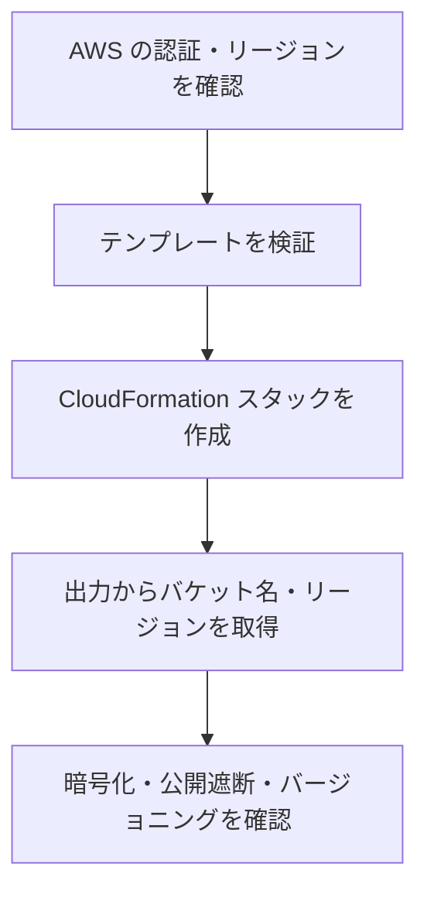
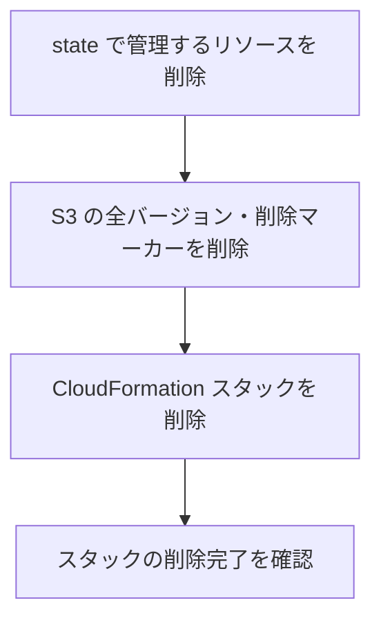

# Terraform state 用 S3

Terraform の state を保存する S3 バケットを CloudFormation で管理します。バケット自身の管理に Terraform を使わないため、state の初期移行は不要です。

## 目次

- [構成と設定](#構成と設定)
- [準備と確認の流れ](#準備と確認の流れ)
- [作成](#作成)
- [設定の確認](#設定の確認)
- [削除](#削除)
- [ローカルの静的検査](#ローカルの静的検査)

## 構成と設定

| 対象 | 設定と役割 |
| --- | --- |
| バケット名 | CloudFormation が一意な名前を生成 |
| バージョニング | 上書き前の state を保存し、復旧に利用 |
| 保存時の暗号化 | SSE-S3。S3 が管理する鍵を使用 |
| 公開アクセス | Block Public Access の4設定を有効化 |
| ACL | `BucketOwnerEnforced` で無効化 |
| 通信 | バケットとオブジェクトに対する HTTP アクセスを拒否 |
| スタック削除 | 空のバケットとバケットポリシーを削除 |

このポリシーは HTTP を拒否するもので、HTTPS のアクセス権を付与するものではありません。state を読み書きする主体には、別途 IAM の権限が必要です。

## 準備と確認の流れ

- AWS CLI と、S3・CloudFormation を操作できる認証を用意します。
- SSO を利用する場合は、使用するプロファイルでログインします。
- `AWS_PROFILE` でプロファイルを選択し、その `region` を使用します。`AWS_REGION` などを指定している場合は、その値が優先されます。
- 以下のコマンドは `aws-mtls/` で実行します。



## 作成

CloudFormation のテンプレート検証は AWS に接続しますが、リソースは作成しません。

```sh
aws cloudformation validate-template \
  --template-body file://infra/state/template.yaml
```

次の操作でスタックを作成します。同名のスタックがある場合は更新になります。

```sh
aws cloudformation deploy \
  --stack-name mtls-poc-state \
  --template-file infra/state/template.yaml
```

作成されたバケット名とリージョンを確認します。

```sh
aws cloudformation describe-stacks \
  --stack-name mtls-poc-state \
  --query 'Stacks[0].Outputs' \
  --output table
```

| 出力 | 用途 |
| --- | --- |
| `StateBucketName` | Terraform の S3 backend の `bucket` |
| `StateBucketRegion` | Terraform の S3 backend の `region` |

## 設定の確認

出力からバケット名を取得し、実際の設定を確認します。

```sh
STATE_BUCKET=$(aws cloudformation describe-stacks \
  --stack-name mtls-poc-state \
  --query 'Stacks[0].Outputs[?OutputKey==`StateBucketName`].OutputValue | [0]' \
  --output text)

aws s3api get-bucket-versioning --bucket "$STATE_BUCKET"
aws s3api get-bucket-encryption --bucket "$STATE_BUCKET"
aws s3api get-public-access-block --bucket "$STATE_BUCKET"
aws s3api get-bucket-ownership-controls --bucket "$STATE_BUCKET"
aws s3api get-bucket-policy --bucket "$STATE_BUCKET" --query Policy --output text
```

各値が「構成と設定」の表と一致することを確認します。

## 削除

state を利用するリソースを削除し終えてから、バケット内の全オブジェクトバージョンと削除マーカーを削除し、最後にスタックを削除します。



- 作成直後で何も保存していないバケットは、そのままスタックを削除できます。
- state を保存した場合は、S3 コンソールで対象バケットの「バージョンの表示」を有効にし、全バージョンと削除マーカーを削除します。
- `aws s3 rm --recursive` だけでは過去バージョンを消せません。中身が残るとスタックの削除は失敗します。

```sh
aws cloudformation delete-stack --stack-name mtls-poc-state
aws cloudformation wait stack-delete-complete --stack-name mtls-poc-state
```

S3 の削除条件は [AWS::S3::Bucket](https://docs.aws.amazon.com/AWSCloudFormation/latest/TemplateReference/aws-resource-s3-bucket.html) を参照してください。

## ローカルの静的検査

```sh
uv sync --locked --dev --python 3.13
uv run --locked cfn-lint infra/state/template.yaml
```

[cfn-lint](https://github.com/aws-cloudformation/cfn-lint) でテンプレートの構造・プロパティ・値などを静的検査します。AWS への接続は不要です。CloudFormation の受理可否と、作成後の設定確認は上記の手順で行います。
