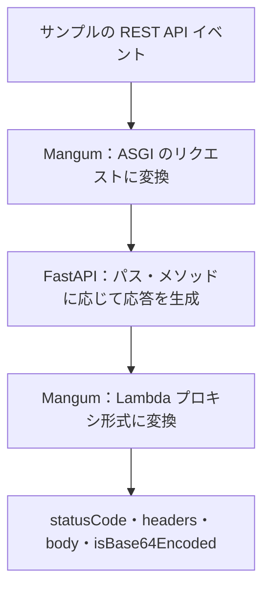

# Lambda 用アプリのイベント変換

## 目次

- [目的と条件](#目的と条件)
- [構成要素と処理の流れ](#構成要素と処理の流れ)
- [イベントと応答の対応](#イベントと応答の対応)
- [検証の範囲](#検証の範囲)

## 目的と条件

- API Gateway REST API のイベントを Mangum に渡し、FastAPI の応答が Lambda プロキシ形式になる仕組みを理解する。
- `aws-mtls/` は独立した Python プロジェクト。ネットワークで待ち受けず、ハンドラーをローカルで直接呼び出す。
- サンプルは REST API のイベント形式。HTTP API の payload v2 ではない。

実行手順は [aws-mtls/README.md](../../aws-mtls/README.md) を参照する。

## 構成要素と処理の流れ

- 図の入力・出力変換は、同じ `handler = Mangum(app)` が担当。
- FastAPI は HTTP の処理を担当し、Lambda イベント自体は解析しない。
- TLS・証明書検証を行う要素は、このローカル呼び出しには含まれない。

| 要素 | 役割 | 実装・データ |
| --- | --- | --- |
| サンプルイベント | HTTP のパス・メソッド・ヘッダーなどを表す辞書 | [get-root.json](../../aws-mtls/tests/events/get-root.json) |
| Mangum | Lambda イベントと ASGI の入出力を変換 | [handler.py](../../aws-mtls/lambda_app/handler.py) |
| FastAPI | `GET /` の JSON 応答と、未定義パス・メソッドの HTTP エラーを生成 | [app.py](../../aws-mtls/lambda_app/app.py) |

## イベントと応答の対応

| 入力・出力 | 値 | 意味 |
| --- | --- | --- |
| 入力 `httpMethod`・`path` | `GET`・`/` | FastAPI のルートを呼び出す |
| 入力 `requestContext` | ステージ・架空の識別子・送信元 IP など | REST API のリクエスト情報を再現 |
| 出力 `statusCode` | `200` | HTTP の応答ステータス |
| 出力 `headers` | `content-type: application/json` など | HTTP の応答ヘッダー |
| 出力 `body` | `{"message":"Hello from Lambda"}` という文字列 | FastAPI が生成した JSON 本文 |
| 出力 `isBase64Encoded` | `false` | 本文は Base64 エンコードされていない |

- `handler(event, context)` の戻り値は辞書で、その中の `body` は文字列。
- ローカルでは `context=None`。このアプリは Lambda context の属性を使わない。
- サンプルには実環境の情報や証明書を含めない。イベントを渡せたことは、mTLS 認証の成功を意味しない。

## 検証の範囲

[test_handler.py](../../aws-mtls/tests/test_handler.py) では、実際の Mangum ハンドラーにイベントを渡す。

| ケース | アプリの挙動 | 変換後の応答 |
| --- | --- | --- |
| `GET /` | JSON メッセージを生成 | `200`・JSON の Content-Type・期待する本文・Base64 フラグ `false` |
| `GET /missing` | 未定義のパスを処理 | `404`・`{"detail":"Not Found"}` |
| `POST /` | 未対応のメソッドを処理 | `405`・`{"detail":"Method Not Allowed"}`・許可メソッド `GET` |
| 同じハンドラーを連続呼び出し | 各イベントを処理 | どちらも正常応答 |

- 404・405 も FastAPI からの HTTP 応答として返る。TLS ハンドシェイクでの拒否とは異なる。
- 実際の API Gateway・Lambda・TLS・証明書拒否ログは、このローカル検証の対象外。

形式の根拠は [AWS の REST API 入出力仕様](https://docs.aws.amazon.com/apigateway/latest/developerguide/set-up-lambda-proxy-integrations.html) と [Mangum のアダプター仕様](https://mangum.fastapiexpert.com/adapter/) を参照する。
