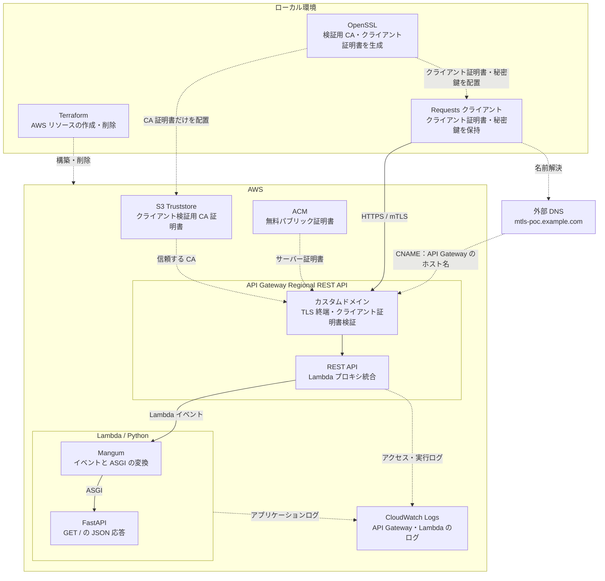
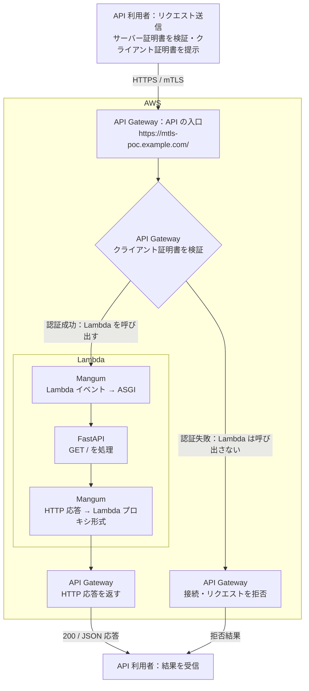

# AWS mTLS の構成と認証の流れ

## 目次

- [目的](#目的)
- [概要](#概要)
- [全体構成](#全体構成)
- [API 利用者から見た処理の流れ](#api-利用者から見た処理の流れ)
- [構成要素の役割](#構成要素の役割)
- [DNS と証明書](#dns-と証明書)
  - [名前解決とドメイン所有確認](#名前解決とドメイン所有確認)
  - [証明書の提示と検証](#証明書の提示と検証)
- [参考資料](#参考資料)

## 目的

API Gateway と Lambda を組み合わせた mTLS の構成と、証明書認証から HTTP 応答までの流れを理解する。

## 概要

- API 利用者はサーバー証明書を検証し、自分のクライアント証明書を提示する。
- API Gateway はクライアント証明書を検証し、認証を通過したリクエストを Lambda に渡す。
- Lambda では Mangum がイベントを ASGI に変換し、FastAPI が応答を生成する。

Lambda ハンドラーのイベント変換は [Lambda 用アプリの検証記録](aws-lambda.md)、ローカルでの実行方法は [aws-mtls/README.md](../../aws-mtls/README.md) を参照。

## 全体構成

- 実線：リクエストの処理経路。応答は逆方向。
- 破線：DNS・証明書・構築・ログの関係。DNS は名前解決を担い、HTTP リクエストを中継しない。
- 検証用 CA・クライアントの秘密鍵はローカルに保持し、S3 Truststore には CA 証明書を配置する。

## API 利用者から見た処理の流れ

- 上下の API 利用者は、同じ利用者によるリクエスト送信と結果受信。
- Mangum の2つの箱は、同じアダプターによる入力・出力変換。
- クライアント証明書の検証で拒否されたリクエストは、Lambda に渡らない。

## 構成要素の役割

| 要素 | 役割 |
| --- | --- |
| Requests クライアント | サーバー証明書を検証し、自分の証明書と秘密鍵を使って接続する |
| API Gateway Regional REST API | カスタムドメインで TLS を終端し、クライアント証明書を検証。HTTP リクエストを Lambda イベントとして渡す |
| ACM | API Gateway が提示するサーバー証明書を管理する |
| S3 Truststore | クライアント証明書の発行元として信頼する CA 証明書を保持する |
| Mangum | Lambda イベントと ASGI の入出力を相互に変換する |
| FastAPI | HTTP のパス・メソッドに応じて処理し、JSON 応答を生成する |
| CloudWatch Logs | API Gateway のアクセス・実行ログと、Lambda の実行ログを記録する |
| Terraform | AWS リソースの構成をコードで定義し、作成・削除する |

- カスタムドメインの mTLS は、既定の `execute-api` エンドポイントには適用されない。入口を限定するには既定エンドポイントの無効化が必要。
- 証明書による認証は、利用者に操作権限を割り当てる認可とは別の処理。

## DNS と証明書

### 名前解決とドメイン所有確認

| DNS レコード | 役割 |
| --- | --- |
| API 接続用 CNAME | `mtls-poc.example.com` を API Gateway の Regional ホスト名に対応付ける |
| ACM 検証用 CNAME | ドメインの所有を確認し、証明書の発行・自動更新に使用する |

- API 接続用と ACM 検証用の CNAME は用途が異なる。
- Regional カスタムドメインの ACM 証明書は、API と同じリージョンに配置する。
- ACM 検証用 CNAME は、証明書の自動更新にも使用する。

証明書は [証明書用 Terraform](../../aws-mtls/infra/certificate/main.tf) で申請し、検証用 CNAME を出力する。申請と発行待ちを分けることで、外部 DNS を手動設定できる。DNS 登録後は AWS CLI で `ISSUED` を確認する。実行手順は [ACM サーバー証明書](../../aws-mtls/infra/certificate/README.md) を参照。

### 証明書の提示と検証

| 証明書 | 提示する側 | 検証する側 | 信頼する発行元 |
| --- | --- | --- | --- |
| サーバー証明書 | API Gateway | API 利用者のクライアント | ACM パブリック証明書の公開 CA |
| クライアント証明書 | API 利用者のクライアント | API Gateway | S3 Truststore に配置した検証用 CA |

- Truststore には、クライアント証明書の発行元からルート CA までの信頼チェーンを含める。
- 証明書は相手に提示する。対応する秘密鍵は送信せず、鍵の所持を署名で証明する。

## 参考資料

- [API Gateway の mTLS](https://docs.aws.amazon.com/apigateway/latest/developerguide/rest-api-mutual-tls.html)
- [Regional カスタムドメイン](https://docs.aws.amazon.com/apigateway/latest/developerguide/apigateway-regional-api-custom-domain-create.html)
- [ACM の DNS 検証](https://docs.aws.amazon.com/acm/latest/userguide/dns-validation.html)
