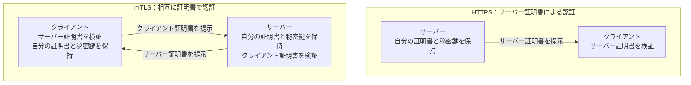
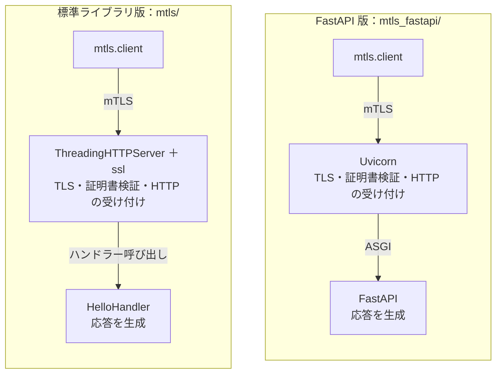

# ローカル mTLS POC

## 目次

- [目的と対象](#目的と対象)
- [現在の構成](#現在の構成)
- [HTTPS と mTLS の違い](#https-と-mtls-の違い)
  - [証明書の提示と検証の方向](#証明書の提示と検証の方向)
  - [認証に関係するコード差分](#認証に関係するコード差分)
    - [サーバー側](#サーバー側)
    - [クライアント側](#クライアント側)
    - [引数と設定](#引数と設定)
  - [アプリケーションと TLS の役割](#アプリケーションと-tls-の役割)
- [コードと証明書設定の対応](#コードと証明書設定の対応)
  - [mTLS サーバーの構成比較](#mtls-サーバーの構成比較)
  - [HTTPS の実装](#https-の実装)
  - [mTLS の実装](#mtls-の実装)
  - [FastAPI と Uvicorn の実装](#fastapi-と-uvicorn-の実装)
  - [urllib と Requests の実装比較](#urllib-と-requests-の実装比較)
    - [Requests の HTTPS と mTLS の差分](#requests-の-https-と-mtls-の差分)
  - [証明書の生成と用途](#証明書の生成と用途)
- [接続時の挙動](#接続時の挙動)
  - [HTTPS のサーバー認証](#https-のサーバー認証)
  - [mTLS のクライアント認証の比較](#mtls-のクライアント認証の比較)
  - [検証の範囲](#検証の範囲)

## 目的と対象

AC と RA 間の HTTPS 通信で使うクライアント証明書認証を理解するため、Python と OpenSSL で TLS/mTLS を小さく実装して検証する。

`tls/` にはサーバー証明書を検証する HTTPS、`mtls/` にはクライアント証明書も検証する mTLS を、独立した学習例として実装している。`mtls/` は正常接続と、証明書なし・非信頼 CA の証明書の拒否を検証する。`mtls_fastapi/` には FastAPI + Uvicorn による別のサーバー実装を置き、既存クライアントで正常接続と、証明書なし・非信頼 CA の証明書の拒否を検証する。`tls/client_requests.py` と `mtls/client_requests.py` はそれぞれ HTTPS と mTLS を Requests で実装し、urllib 版と比較する。AWS 上の構成や本番の AC 接続仕様は、このローカル検証の対象に含めない。

実行方法は [local-mtls/README.md](../../local-mtls/README.md) を参照する。この文書には検証の目的、仕組み、結果を残す。

## 現在の構成

1. OpenSSL で検証用の自己署名ルート CA を作る。
2. サーバー・クライアント用の秘密鍵と CSR（証明書署名要求）を作り、同じ CA でそれぞれの用途の証明書を発行する。
3. Python のサーバーが、サーバー証明書と秘密鍵を読み込んで待ち受ける。mTLS 版では、クライアント証明書の検証用 CA と `CERT_REQUIRED` も設定する。
4. クライアントが信頼する CA 証明書を指定し、サーバー証明書を検証する。mTLS 版では自分の証明書と秘密鍵も読み込み、相互に証明書を検証してから HTTP GET を送る。

| ファイル | 役割 |
| --- | --- |
| `ca.crt` | 相手の証明書の検証に使う CA 証明書。mTLS 版では両側が使用 |
| `ca.key` | サーバー・クライアント証明書の署名に使う CA の秘密鍵 |
| `server.csr` | サーバー証明書の発行を求める署名要求 |
| `server.crt` | CA が署名したサーバー証明書 |
| `server.key` | TLS サーバーが使う秘密鍵 |
| `client.csr` | クライアント証明書の発行を求める署名要求 |
| `client.crt` | CA が署名したクライアント認証用の証明書 |
| `client.key` | TLS クライアントが使う秘密鍵 |

手動実行用のファイルは `local-mtls/certs/generated/` に生成する。生成物は Git 管理対象外とし、設定ファイルとスクリプトから作り直せるようにしている。テストでは一時ディレクトリに生成し、テスト終了後に削除する。

## HTTPS と mTLS の違い

ここでは、`tls/` のサーバー証明書だけを使う HTTPS と、`mtls/` のクライアント証明書も使う HTTPS を比較する。mTLS でも HTTP のリクエスト・レスポンスは同じ仕組みで、TLS 接続時の認証設定が異なる。

### 証明書の提示と検証の方向

矢印は証明書を提示する方向を示す。受け取る側は、あらかじめ信頼する CA を設定して相手の証明書を検証する。TLS ハンドシェイクの全メッセージや送信順序は省略している。



秘密鍵は相手に送らない。TLS の中で署名に使い、提示した証明書に対応する秘密鍵を持つことを証明する。

### 認証に関係するコード差分

#### サーバー側

サーバー側では、自分の証明書を読み込む既存の処理に、クライアント検証用 CA と証明書必須の設定を追加する。

```diff
 context = ssl.SSLContext(ssl.PROTOCOL_TLS_SERVER)
 context.load_cert_chain(certfile=str(certfile), keyfile=str(keyfile))
+context.load_verify_locations(cafile=str(cafile))
+context.verify_mode = ssl.CERT_REQUIRED
```

#### クライアント側

サーバーを検証する既存の設定に、自分の証明書と秘密鍵の読み込みを追加する。

```diff
 context = ssl.create_default_context(cafile=str(cafile))
+context.load_cert_chain(certfile=str(certfile), keyfile=str(keyfile))
```

#### 引数と設定

| 追加設定 | 役割 | 入力するファイル |
| --- | --- | --- |
| サーバーの `load_verify_locations` | クライアント証明書の発行元として信頼する CA を指定 | `--client-ca` の CA 証明書 |
| サーバーの `CERT_REQUIRED` | クライアント証明書の提示と検証を必須にする | なし |
| クライアントの `load_cert_chain` | 自分の証明書と対応する秘密鍵を読み込む | `--certfile`・`--keyfile` |

この追加に合わせて関数と CLI の引数を増やしている。応答文言・クラス名・既定ポートの違いは、学習例を区別するための変更であり、mTLS の認証要件ではない。

### アプリケーションと TLS の役割

追加コードが少ないのは、証明書の送受信や暗号処理を Python の `ssl` と内部の OpenSSL が担うため。

| 担当 | 役割 |
| --- | --- |
| アプリケーションの TLS 設定 | 自分の証明書・秘密鍵、信頼する CA、クライアント証明書を必須にするかを指定 |
| `ssl`・OpenSSL | TLS ハンドシェイク、証明書の検証、秘密鍵を持つことの証明、暗号化通信を実行 |
| アプリケーションの認可処理 | 認証された相手に許可する操作を決める。今回の POC では未実装 |

今回のサーバーは、信頼する CA によるクライアント証明書の検証が通ると固定メッセージを返す。個々のクライアントに操作権限を割り当てる認可は、証明書による認証とは別の処理になる。

## コードと証明書設定の対応

### mTLS サーバーの構成比較

- 比較条件：同じクライアント・証明書を使い、mTLS サーバーの構成要素を比較。
- 矢印：リクエストの処理方向。



- 標準ライブラリ版：`ssl` でサーバーのソケットを包み、`HelloHandler` を呼び出す。
- FastAPI 版：Uvicorn が接続を受け付け、ASGI 経由で FastAPI を呼び出す。
- 共通：クライアント証明書の検証後に、同じ応答本文を返す。

### HTTPS の実装

| ファイル | 主な処理 |
| --- | --- |
| [tls/server.py](../../local-mtls/tls/server.py) | `load_cert_chain` でサーバー証明書と秘密鍵を読み込み、`wrap_socket` で HTTP サーバーのソケットに TLS を追加する |
| [tls/client.py](../../local-mtls/tls/client.py) | `create_default_context(cafile=...)` で信頼する CA を指定し、証明書検証と接続先のホスト名検証を有効にする |

### mTLS の実装

| ファイル | HTTPS 版から追加する処理 |
| --- | --- |
| [mtls/server.py](../../local-mtls/mtls/server.py) | `load_verify_locations` でクライアント検証用 CA を読み込み、`CERT_REQUIRED` で証明書の提示と検証を必須にする |
| [mtls/client.py](../../local-mtls/mtls/client.py) | `load_cert_chain` で自分の証明書と秘密鍵を追加する。サーバー証明書の検証も行う |

### FastAPI と Uvicorn の実装

HTTP の応答処理を FastAPI、ポートの待ち受けと TLS の処理を Uvicorn に分ける。クライアントと証明書を共通にして、サーバーだけを置き換える。

| ファイル | 役割 |
| --- | --- |
| [mtls_fastapi/app.py](../../local-mtls/mtls_fastapi/app.py) | `GET /` に対して `PlainTextResponse` を返す。本文と改行は標準ライブラリ版と同じ |
| [mtls_fastapi/server.py](../../local-mtls/mtls_fastapi/server.py) | Uvicorn にサーバー証明書・秘密鍵・クライアント検証用 CA・証明書必須設定を渡し、FastAPI アプリを起動する |

| 標準ライブラリ版の設定 | Uvicorn に渡す設定 |
| --- | --- |
| `load_cert_chain(certfile, keyfile)` | `ssl_certfile`・`ssl_keyfile` |
| `load_verify_locations(cafile)` | `ssl_ca_certs` |
| `verify_mode = ssl.CERT_REQUIRED` | `ssl_cert_reqs=ssl.CERT_REQUIRED` |

### urllib と Requests の実装比較

- 同じ URL・CA・クライアント証明書・秘密鍵で接続し、クライアント実装だけを比較。
| 認証方式 | urllib 版 | Requests 版 |
| --- | --- | --- |
| HTTPS（サーバー認証） | [tls/client.py](../../local-mtls/tls/client.py) | [tls/client_requests.py](../../local-mtls/tls/client_requests.py) |
| mTLS（相互認証） | [mtls/client.py](../../local-mtls/mtls/client.py) | [mtls/client_requests.py](../../local-mtls/mtls/client_requests.py) |

| 役割 | urllib 版 | Requests 版 |
| --- | --- | --- |
| サーバー証明書・ホスト名の検証 | `ssl.create_default_context(cafile=...)` | `verify=cafile` |
| 自分の証明書・秘密鍵の指定 | `context.load_cert_chain(certfile, keyfile)` | `cert=(certfile, keyfile)` |
| HTTPS GET | `urlopen(url, context=context, timeout=5)` | `requests.get(url, verify=..., cert=..., timeout=5)` |
| 応答の文字列化 | `response.read().decode("utf-8")` | `response.text`（応答の文字コード指定を使用） |
| HTTP 4xx・5xx | `urlopen` が `HTTPError` を送出 | `raise_for_status()` で `HTTPError` を送出 |
| 証明書なしの指定 | `tls.client` を使用 | 証明書・秘密鍵を両方省略（`cert=None`） |

- `verify` は相手を信頼する条件、`cert` は自分を証明するファイル。
- Requests 版も接続・読み取りの待ち時間を `timeout=5` で指定。リクエスト全体の完了期限ではない。
- 証明書と秘密鍵の片方だけを指定した場合は、接続前に入力エラー。

#### Requests の HTTPS と mTLS の差分

```diff
 requests.get(
     url,
     verify=str(cafile),
+    cert=(str(certfile), str(keyfile)),
     timeout=5,
 )
```

- 共通：`verify` でサーバーを検証し、応答本文を返す。サーバーコードは変更不要。
- mTLS：`cert` でクライアント自身の証明書・秘密鍵を追加。
- mTLS 版の省略・入力チェック：証明書なしの拒否を試すための処理。正常接続の認証設定の差は上記の `cert`。

### 証明書の生成と用途

| ファイル | 役割 |
| --- | --- |
| [generate-certs.sh](../../local-mtls/scripts/generate-certs.sh) | CA とサーバー・クライアント証明書を生成する |
| [server-ext.cnf](../../local-mtls/scripts/server-ext.cnf) | `serverAuth` で用途を指定し、SAN に `localhost` と `127.0.0.1` を含める。鍵識別子を設定して証明書チェーンの検証に使う |
| [client-ext.cnf](../../local-mtls/scripts/client-ext.cnf) | 用途を `clientAuth` に限定し、`digitalSignature` を秘密鍵の所持証明に使う。鍵識別子を証明書チェーンの検証に使う |

## 接続時の挙動

### HTTPS のサーバー認証

`tls/` の HTTPS 版では、サーバーと接続先を固定し、クライアントが信頼する CA を変えて比較する。

| 接続条件 | 共通の HTTP 処理 | urllib 版の出力 | Requests 版の出力 |
| --- | --- | --- | --- |
| サーバー証明書の発行元 CA を信頼する | 200 と固定本文を返す | `ローカル HTTPS サーバーからの応答です。` | `ローカル HTTPS サーバーからの応答です。` |
| 別の CA を信頼する | クライアントが TLS 段階で拒否、HTTP 処理なし | `URLError` 内の `SSLCertVerificationError`：`CERTIFICATE_VERIFY_FAILED` | `requests.exceptions.SSLError`：`CERTIFICATE_VERIFY_FAILED` |

### mTLS のクライアント認証の比較

- サーバー検証用 CA は正常なまま、クライアント証明書の有無と発行元を変更。
- 同じ条件でサーバーとクライアントを置き換え、拒否される条件と例外の見え方を比較。

| サーバー | 接続条件 | 共通の HTTP 処理 | urllib 版の出力 | Requests 版の出力 |
| --- | --- | --- | --- | --- |
| 両サーバー | 正常なクライアント証明書 | 200 と同じ固定本文を返す | `ローカル mTLS サーバーからの応答です。` | `ローカル mTLS サーバーからの応答です。` |
| 標準ライブラリ版 | クライアント証明書なし | TLS 段階で拒否、HTTP 処理なし | `ssl.SSLError`（`URLError` 内の場合もある）：`CERTIFICATE_REQUIRED` など | `requests.exceptions.SSLError`：`CERTIFICATE_REQUIRED` など |
| 標準ライブラリ版 | 非信頼 CA のクライアント証明書 | TLS 段階で拒否、HTTP 処理なし | `ssl.SSLError`（`URLError` 内の場合もある）：`UNKNOWN_CA` | `requests.exceptions.SSLError`：`UNKNOWN_CA` |
| FastAPI 版 | クライアント証明書なし | TLS 段階で拒否、HTTP 処理なし | `http.client.RemoteDisconnected` | `requests.exceptions.ConnectionError`：内部に `RemoteDisconnected` |
| FastAPI 版 | 非信頼 CA のクライアント証明書 | TLS 段階で拒否、HTTP 処理なし | `http.client.RemoteDisconnected` | `requests.exceptions.ConnectionError`：内部に `RemoteDisconnected` |
| 両サーバー | サーバー検証用 CA が不正（自分の証明書は正常） | クライアントが TLS 段階で拒否、HTTP 処理なし | `URLError` 内の `SSLCertVerificationError`：`CERTIFICATE_VERIFY_FAILED` | `requests.exceptions.SSLError`：`CERTIFICATE_VERIFY_FAILED` |

- 出力はこの実装での例。TLS バージョンや実行環境でアラート・切断・リセットなど表記が変わる。
- `RemoteDisconnected` のメッセージ：`Remote end closed connection without response`。
- 拒否時は HTTP の 401・403 を返さず、FastAPI も呼び出されない。
- 拒否後もサーバーは正常な証明書による接続を受け付ける。
- 例外名だけでは拒否理由を特定できない。接続拒否やタイムアウトとも区別する。

操作手順は [HTTPS の確認](../../local-mtls/README.md#https-の確認)、[mTLS の確認](../../local-mtls/README.md#mtls-の確認) を参照する。

### 検証の範囲

[HTTPS の Requests 版テスト](../../local-mtls/tests/test_tls_requests.py) は、既存の HTTPS サーバーで正常接続と非信頼 CA によるサーバー認証失敗を検証する。手順は [HTTPS の確認](../../local-mtls/README.md#https-の確認) を参照する。

[HTTPS のテスト](../../local-mtls/tests/test_tls.py) はサーバー証明書の発行元による違い、[mTLS のテスト](../../local-mtls/tests/test_mtls.py) はクライアント証明書の提示有無と発行元による違いを検証する。

[FastAPI 版のテスト](../../local-mtls/tests/test_mtls_fastapi.py) は実際の Uvicorn に接続し、拒否したリクエストが HTTP 処理へ到達しないことと、拒否前後の正常接続を検証する。接続拒否やタイムアウト、クライアント側のサーバー証明書検証失敗は、クライアント認証の拒否として扱わない。

[Requests 版のテスト](../../local-mtls/tests/test_mtls_requests.py) は両サーバーに対し、正常接続・証明書なし・非信頼 CA の証明書・サーバー検証用 CA の不一致を検証する。クライアント認証の拒否前後にも正常接続し、サーバー停止による失敗と区別する。証明書と秘密鍵の片方だけの指定と、HTTP エラーの伝播は単体テストで検証する。

ホスト名不一致や有効期限切れは個別のテストにしていない。
