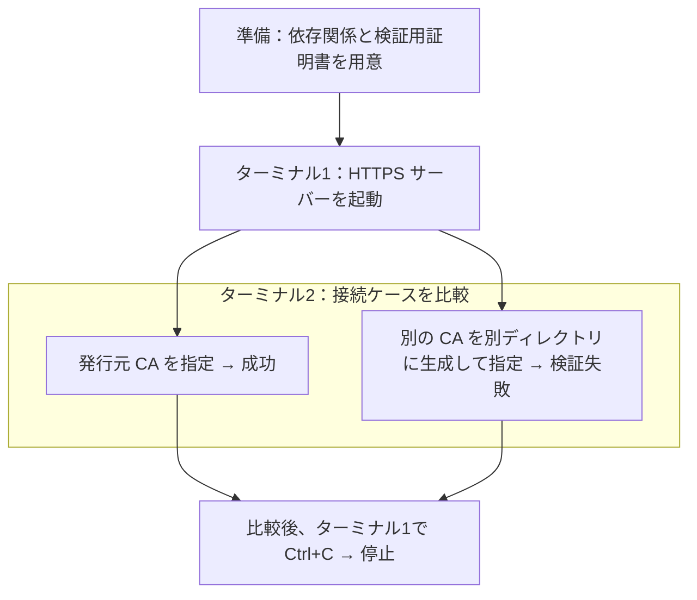
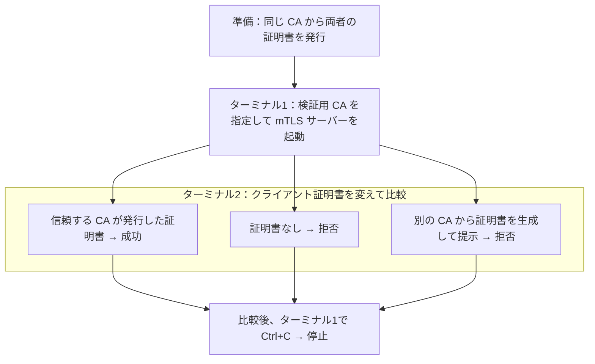
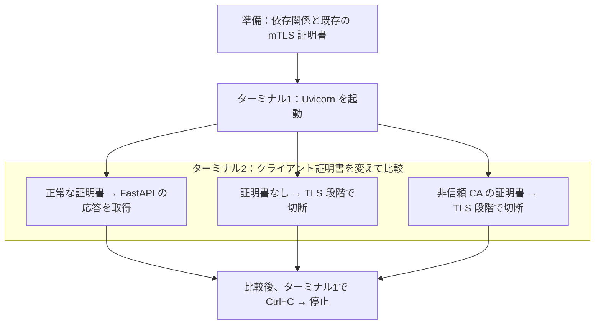

# ローカル mTLS

Python と OpenSSL を使い、ローカルで TLS と mTLS の動作を学ぶための領域です。標準ライブラリ版と FastAPI + Uvicorn 版を比較します。

## 目次

- [構成](#構成)
- [実行環境](#実行環境)
- [HTTPS の確認](#https-の確認)
  - [環境と証明書の準備](#環境と証明書の準備)
  - [接続成功の確認](#接続成功の確認)
  - [証明書検証失敗の確認](#証明書検証失敗の確認)
- [mTLS の確認](#mtls-の確認)
  - [証明書の準備](#証明書の準備)
  - [クライアント証明書による接続](#クライアント証明書による接続)
  - [クライアント証明書なしの接続](#クライアント証明書なしの接続)
  - [非信頼 CA のクライアント証明書による接続](#非信頼-ca-のクライアント証明書による接続)
  - [相互認証の設定](#相互認証の設定)
- [FastAPI と Uvicorn による mTLS の確認](#fastapi-と-uvicorn-による-mtls-の確認)
  - [依存関係と証明書](#依存関係と証明書)
  - [サーバーの起動と接続](#サーバーの起動と接続)
  - [FastAPI 版への証明書なしの接続](#fastapi-版への証明書なしの接続)
  - [FastAPI 版への非信頼 CA の証明書による接続](#fastapi-版への非信頼-ca-の証明書による接続)
- [自動テスト](#自動テスト)
- [コード整形と静的検査](#コード整形と静的検査)
- [検証記録](#検証記録)

## 構成

```text
.
├── tls/               # クライアント証明書を要求しない HTTPS の学習例
│   ├── __init__.py
│   ├── server.py
│   └── client.py
├── mtls/              # 相互に証明書を検証する HTTPS の学習例
│   ├── __init__.py
│   ├── server.py
│   └── client.py
├── mtls_fastapi/      # HTTP 処理と TLS を受け付けるサーバーを分離した学習例
│   ├── __init__.py
│   ├── app.py
│   └── server.py
├── tests/
│   ├── test_tls.py
│   ├── test_mtls.py
│   └── test_mtls_fastapi.py
└── scripts/           # 証明書生成スクリプトと拡張設定
```

`tls/` と `mtls/` は標準ライブラリによる独立した学習例です。`mtls_fastapi/` は HTTP 処理を FastAPI、待ち受けと TLS を Uvicorn に任せます。クライアントは既存の `mtls.client` を使います。

## 実行環境

- Python 3.13 以上
- [uv](https://docs.astral.sh/uv/)
- OpenSSL

`tls/` と `mtls/` は標準ライブラリのみで動作します。`mtls_fastapi/` は FastAPI と Uvicorn を使用します。実行時の依存関係と、開発用の pytest・Ruff は `pyproject.toml` と `uv.lock` で管理します。

## HTTPS の確認

サーバーを起動したまま、ターミナル2で信頼する CA を変えて接続結果を比較します。



分岐は同じサーバーに対して試す接続ケースを表します。サーバーは起動したまま、ターミナル2で各ケースを順に実行します。

### 環境と証明書の準備

以降のコマンドはすべて `local-mtls/` で実行します。

```sh
uv sync
sh scripts/generate-certs.sh
```

### 接続成功の確認

ターミナル1で HTTPS サーバーを起動します。`server.crt` と `server.key` はサーバーの身元を示します。

```sh
uv run python -m tls.server \
  --certfile certs/generated/server.crt \
  --keyfile certs/generated/server.key
```

ターミナル2から、CA 証明書を指定して接続します。クライアントは CA 署名と URL のホスト名の両方を検証します。

```sh
uv run python -m tls.client \
  --url https://127.0.0.1:8443/ \
  --cafile certs/generated/ca.crt
```

信頼した CA がサーバー証明書を発行していれば接続でき、別の CA では検証に失敗します。`tls.server` はクライアント証明書を要求せず、クライアントがサーバーを検証する片方向の TLS です。

### 証明書検証失敗の確認

ターミナル1のサーバーを起動したまま、ターミナル2で別の CA を生成します。元の証明書を上書きしないよう、出力先を分けます。

```sh
sh scripts/generate-certs.sh certs/generated/untrusted
```

このスクリプトは別の CA とサーバー・クライアント証明書一式を生成します。ここでクライアントに指定するのは、そのうちの `ca.crt` だけです。稼働中のサーバーは元の証明書を使い続けます。

```sh
uv run python -m tls.client \
  --url https://127.0.0.1:8443/ \
  --cafile certs/generated/untrusted/ca.crt
```

`CERTIFICATE_VERIFY_FAILED` を含むエラーで終了することを確認します。`Connection refused` などはサーバーの起動状態や通信の問題で、今回確認する証明書検証の失敗とは異なります。

元の CA を指定すると、再び接続できます。

```sh
uv run python -m tls.client \
  --url https://127.0.0.1:8443/ \
  --cafile certs/generated/ca.crt
```

| クライアントの `--cafile` | 期待する結果 |
| --- | --- |
| `certs/generated/ca.crt` | 接続成功。応答本文を取得する |
| `certs/generated/untrusted/ca.crt` | 証明書検証に失敗する |

サーバーと接続先 URL を変えず、クライアントが信頼する CA だけを変えて結果を比較します。確認後はターミナル1で `Ctrl+C` を押してサーバーを停止します。

## mTLS の確認

クライアントがサーバー証明書を検証することに加え、サーバーもクライアント証明書を検証します。



サーバーを起動したまま、ターミナル2で各ケースを順に実行します。クライアント側のサーバー検証用 CA は、すべてのケースで元の CA に固定します。

### 証明書の準備

`local-mtls/` で実行します。依存関係が未準備の場合は、先に `uv sync` を実行します。証明書生成スクリプトは、同じ CA からサーバー・クライアント両方の証明書を発行します。以前生成したファイルに `client.crt`・`client.key` がなければ、サーバーを停止してから再生成してください。再生成すると CA とサーバー証明書・秘密鍵も置き換わります。

```sh
sh scripts/generate-certs.sh
```

### クライアント証明書による接続

ターミナル1で mTLS サーバーを起動します。`--client-ca` は、クライアント証明書を検証するために信頼する CA です。HTTPS 版と区別するため、既定のポートは `8444` にしています。

```sh
uv run python -m mtls.server \
  --certfile certs/generated/server.crt \
  --keyfile certs/generated/server.key \
  --client-ca certs/generated/ca.crt
```

ターミナル2で、クライアント自身の証明書と秘密鍵を指定して接続します。

```sh
uv run python -m mtls.client \
  --url https://127.0.0.1:8444/ \
  --cafile certs/generated/ca.crt \
  --certfile certs/generated/client.crt \
  --keyfile certs/generated/client.key
```

接続できると `ローカル mTLS サーバーからの応答です。` が表示されます。続く拒否ケースを比較するため、サーバーは起動したままにします。

### クライアント証明書なしの接続

ターミナル2で、証明書を提示しない HTTPS 版クライアントから mTLS サーバーに接続します。

```sh
uv run python -m tls.client \
  --url https://127.0.0.1:8444/ \
  --cafile certs/generated/ca.crt
```

`CERTIFICATE_REQUIRED` などの TLS アラートで拒否されることを確認します。TLS バージョンによってはハンドシェイク失敗として表示されます。

### 非信頼 CA のクライアント証明書による接続

ターミナル2で、元の証明書を上書きしない別ディレクトリに証明書を生成します。

```sh
sh scripts/generate-certs.sh certs/generated/untrusted
```

サーバーを検証する `--cafile` は元のままにし、提示するクライアント証明書と秘密鍵だけを変えます。

```sh
uv run python -m mtls.client \
  --url https://127.0.0.1:8444/ \
  --cafile certs/generated/ca.crt \
  --certfile certs/generated/untrusted/client.crt \
  --keyfile certs/generated/untrusted/client.key
```

`UNKNOWN_CA` などの TLS アラートで拒否されることを確認します。`--cafile` まで別の CA に変えると、クライアント側のサーバー証明書検証も失敗するため、比較したい条件が変わってしまいます。

| ケース | サーバーを検証する CA | 提示するクライアント証明書 | 期待する結果 |
| --- | --- | --- | --- |
| 正常 | 元の CA | 元の CA が発行 | 接続成功 |
| 証明書なし | 元の CA | なし | 接続拒否 |
| 非信頼 CA | 元の CA | 別の CA が発行 | 接続拒否 |

`Connection refused` やタイムアウトは、今回確認する TLS による拒否とは区別します。最後に「クライアント証明書による接続」のコマンドを再実行し、元の証明書で接続が成功することを比較します。確認後はターミナル1で `Ctrl+C` を押して停止します。

### 相互認証の設定

| 設定 | サーバー側 | クライアント側 |
| --- | --- | --- |
| 自分を証明するファイル | `server.crt`・`server.key` | `client.crt`・`client.key` |
| 相手を検証する CA | `--client-ca` | `--cafile` |
| Python の設定 | `load_verify_locations` と `CERT_REQUIRED` | `create_default_context` と `load_cert_chain` |

ここでは両側で同じ `ca.crt` を使いますが、検証する相手は異なります。クライアント証明書は `clientAuth`、サーバー証明書は `serverAuth` の用途を持ちます。秘密鍵は相手へ送らず、TLS 内の署名に使います。

正常な証明書による接続に加え、証明書なし・別の CA のクライアント証明書を拒否する動作を自動テストで検証します。

## FastAPI と Uvicorn による mTLS の確認

サーバー実装だけを変え、証明書とクライアントは標準ライブラリ版と同じものを使います。



### 依存関係と証明書

`local-mtls/` で依存関係を同期します。

```sh
uv sync --locked --dev
```

証明書は [mTLS の証明書の準備](#証明書の準備) と同じものを使います。生成済みなら再生成は不要です。

### サーバーの起動と接続

ターミナル1でサーバーを起動します。他の例と区別するため、既定ポートは `8445` です。

```sh
uv run python -m mtls_fastapi.server \
  --certfile certs/generated/server.crt \
  --keyfile certs/generated/server.key \
  --client-ca certs/generated/ca.crt
```

ターミナル2で既存の mTLS クライアントから接続します。

```sh
uv run python -m mtls.client \
  --url https://127.0.0.1:8445/ \
  --cafile certs/generated/ca.crt \
  --certfile certs/generated/client.crt \
  --keyfile certs/generated/client.key
```

`ローカル mTLS サーバーからの応答です。` が表示されます。FastAPI は JSON ではなくプレーンテキストを返すため、標準ライブラリ版と同じ本文になります。サーバーを起動したまま、ターミナル2で拒否ケースを順に試します。

### FastAPI 版への証明書なしの接続

証明書を提示しない HTTPS 版クライアントから接続します。接続先は Uvicorn のポート `8445` です。

```sh
uv run python -m tls.client \
  --url https://127.0.0.1:8445/ \
  --cafile certs/generated/ca.crt
```

### FastAPI 版への非信頼 CA の証明書による接続

別の CA とクライアント証明書を、元のファイルを上書きしない出力先に生成します。

```sh
sh scripts/generate-certs.sh certs/generated/untrusted
```

サーバーを検証する `--cafile` は正常なまま、自分が提示する証明書と秘密鍵だけを変えます。

```sh
uv run python -m mtls.client \
  --url https://127.0.0.1:8445/ \
  --cafile certs/generated/ca.crt \
  --certfile certs/generated/untrusted/client.crt \
  --keyfile certs/generated/untrusted/client.key
```

両方の拒否ケースでは、次のように HTTP 応答を受け取らず切断されます。

```text
http.client.RemoteDisconnected: Remote end closed connection without response
```

環境によっては TLS アラートや接続リセットとして見えることもあります。FastAPI の処理へ到達する前に Uvicorn が TLS 接続を拒否するため、HTTP の 401・403 は返りません。`Connection refused` やタイムアウトは、認証以外の通信失敗として区別します。

最後に正常なクライアント証明書のコマンドを再実行すると、サーバーが接続を受け付け続けることを比較できます。終了時はターミナル1で `Ctrl+C` を押します。

## 自動テスト

テストは一時ディレクトリに CA と証明書を生成し、ループバック接続で次のケースを検証します。

| 学習例 | ケース | 期待する結果 |
| --- | --- | --- |
| HTTPS | 発行元 CA を信頼する | 接続成功 |
| HTTPS | 別の CA を信頼する | サーバー証明書の検証失敗 |
| mTLS | 信頼する CA が発行したクライアント証明書を提示する | 接続成功 |
| mTLS | クライアント証明書を提示しない | 接続拒否 |
| mTLS | 別の CA が発行したクライアント証明書を提示する | 接続拒否 |
| FastAPI + Uvicorn | 信頼する CA が発行したクライアント証明書を提示する | 既存 mTLS 版と同じ本文で接続成功 |
| FastAPI + Uvicorn | クライアント証明書を提示しない | HTTP 処理に到達せず接続を拒否 |
| FastAPI + Uvicorn | 別の CA が発行したクライアント証明書を提示する | HTTP 処理に到達せず接続を拒否 |

```sh
uv run pytest
```

証明書検証の失敗を期待するテストも、期待どおり接続が拒否されればテスト結果は成功になります。

## コード整形と静的検査

Ruff でコードを整形し、構文や未使用変数、import の並び順を検査します。

```sh
uv run ruff format .
uv run ruff check .
```

整形せずに差分の有無だけ確認する場合は、次を実行します。

```sh
uv run ruff format --check .
```

証明書と秘密鍵は `certs/generated/` に生成され、Git の管理対象にはなりません。

## 検証記録

目的、構成、検証結果、次の検証項目は [ローカル mTLS POC の検証記録](../docs/poc/local-mtls.md) にまとめています。
