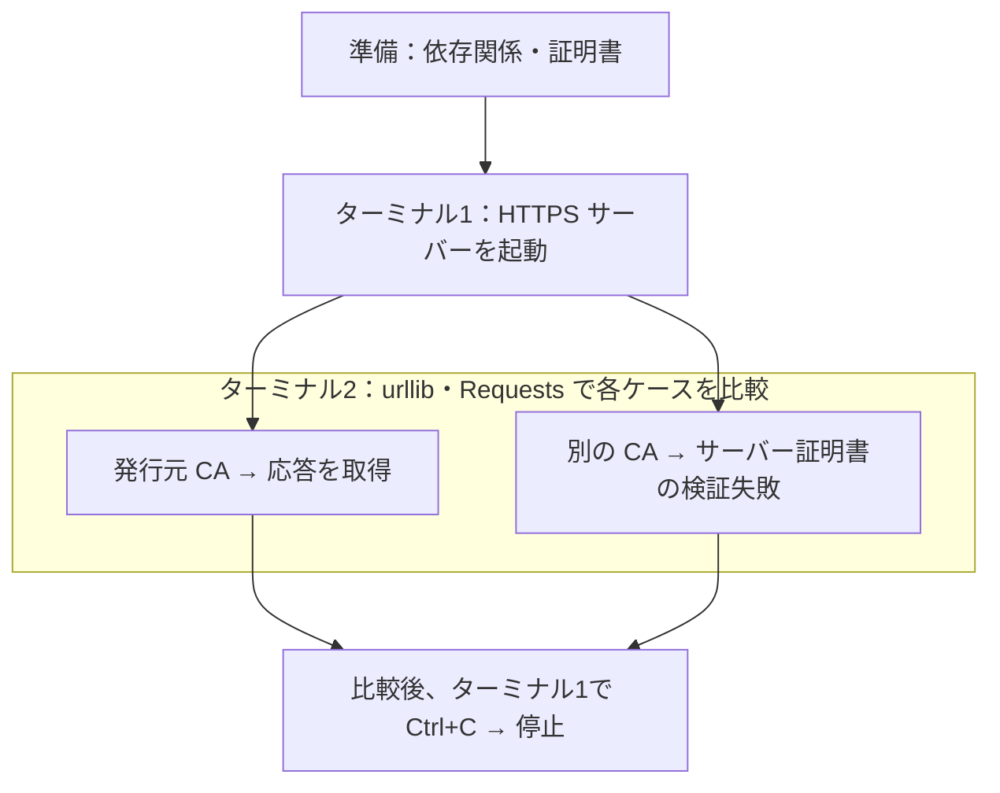
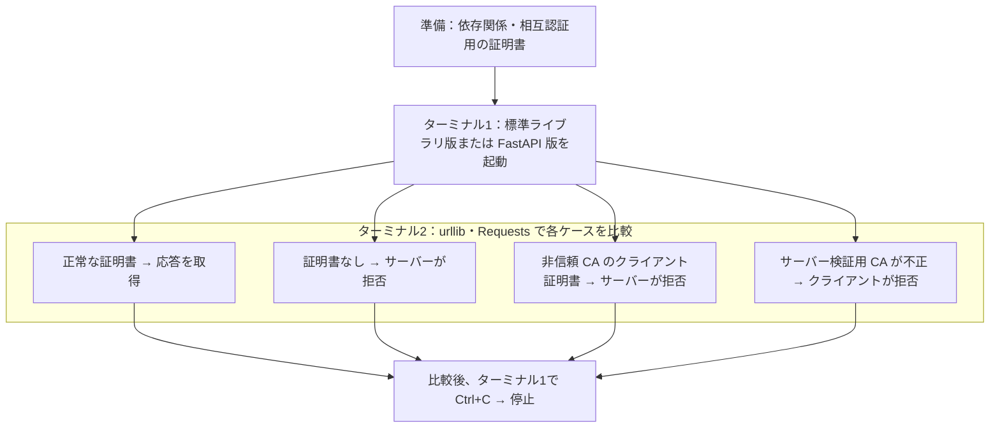

# ローカル mTLS

Python と OpenSSL を使い、ローカルで TLS と mTLS の動作を学ぶための領域です。サーバーは標準ライブラリ版と FastAPI + Uvicorn 版、クライアントは urllib 版と Requests 版を比較します。

## 目次

- [構成](#構成)
- [実行環境](#実行環境)
- [HTTPS の確認](#https-の確認)
  - [環境と証明書の準備](#環境と証明書の準備)
  - [HTTPS サーバーの起動](#https-サーバーの起動)
  - [接続成功の確認](#接続成功の確認)
  - [証明書検証失敗の確認](#証明書検証失敗の確認)
- [mTLS の確認](#mtls-の確認)
  - [証明書の準備](#証明書の準備)
  - [mTLS サーバーの起動](#mtls-サーバーの起動)
    - [標準ライブラリ版](#標準ライブラリ版)
    - [FastAPI 版](#fastapi-版)
  - [クライアント証明書による接続](#クライアント証明書による接続)
  - [クライアント証明書なしの接続](#クライアント証明書なしの接続)
  - [非信頼 CA のクライアント証明書による接続](#非信頼-ca-のクライアント証明書による接続)
  - [サーバー検証用 CA が不正な接続](#サーバー検証用-ca-が不正な接続)
  - [拒否時の出力](#拒否時の出力)
  - [相互認証の設定](#相互認証の設定)
- [自動テスト](#自動テスト)
- [コード整形と静的検査](#コード整形と静的検査)
- [検証記録](#検証記録)

## 構成

```text
.
├── tls/               # クライアント証明書を要求しない HTTPS の学習例
│   ├── __init__.py
│   ├── server.py
│   ├── client.py
│   └── client_requests.py
├── mtls/              # 相互に証明書を検証する HTTPS の学習例
│   ├── __init__.py
│   ├── server.py
│   ├── client.py
│   └── client_requests.py
├── mtls_fastapi/      # HTTP 処理と TLS を受け付けるサーバーを分離した学習例
│   ├── __init__.py
│   ├── app.py
│   └── server.py
├── tests/
│   ├── test_tls.py
│   ├── test_tls_requests.py
│   ├── test_mtls.py
│   ├── test_mtls_fastapi.py
│   └── test_mtls_requests.py
└── scripts/           # 証明書生成スクリプトと拡張設定
```

`tls/` は HTTPS、`mtls/` は mTLS の学習例です。HTTPS・mTLS ともに、クライアントは urllib 版と Requests 版を用意しています。`mtls_fastapi/` は HTTP 処理を FastAPI、待ち受けと TLS を Uvicorn に任せ、同じクライアントから接続できます。

## 実行環境

- Python 3.13 以上
- [uv](https://docs.astral.sh/uv/)
- OpenSSL

`tls/` と `mtls/` の `server.py`・`client.py` は標準ライブラリのみで動作します。両パッケージの `client_requests.py` は Requests、`mtls_fastapi/` は FastAPI と Uvicorn を使用します。実行時の依存関係と、開発用の pytest・Ruff は `pyproject.toml` と `uv.lock` で管理します。

## HTTPS の確認

- サーバーを起動したまま、クライアントと検証用 CA を変えて比較。
- urllib 版・Requests 版とも、サーバー証明書の署名と URL のホスト名を検証。
- HTTPS サーバーはクライアント証明書を要求しない。



### 環境と証明書の準備

以降のコマンドはすべて `local-mtls/` で実行します。証明書が生成済みなら再生成は不要です。

```sh
uv sync --locked --dev
sh scripts/generate-certs.sh
```

### HTTPS サーバーの起動

ターミナル1で起動します。両クライアントで同じサーバーを使います。

```sh
uv run python -m tls.server \
  --certfile certs/generated/server.crt \
  --keyfile certs/generated/server.key
```

### 接続成功の確認

ターミナル2で、サーバー証明書を発行した CA を指定します。

urllib 版：

```sh
uv run python -m tls.client \
  --url https://127.0.0.1:8443/ \
  --cafile certs/generated/ca.crt
```

Requests 版：

```sh
uv run python -m tls.client_requests \
  --url https://127.0.0.1:8443/ \
  --cafile certs/generated/ca.crt
```

- 両クライアントの期待する出力：`ローカル HTTPS サーバーからの応答です。`
- 変えるのはクライアント実装だけ。URL と CA は共通。

### 証明書検証失敗の確認

ターミナル2で別の CA を生成します。元の証明書を上書きしない出力先にします。

```sh
sh scripts/generate-certs.sh certs/generated/untrusted
```

同じサーバー・URL のまま、`--cafile` だけを変更します。

urllib 版：

```sh
uv run python -m tls.client \
  --url https://127.0.0.1:8443/ \
  --cafile certs/generated/untrusted/ca.crt
```

Requests 版：

```sh
uv run python -m tls.client_requests \
  --url https://127.0.0.1:8443/ \
  --cafile certs/generated/untrusted/ca.crt
```

| 接続条件 | urllib 版 | Requests 版 |
| --- | --- | --- |
| 元の CA | 応答本文を取得 | 同じ応答本文を取得 |
| 別の CA | `URLError` 内の `SSLCertVerificationError` | `requests.exceptions.SSLError` |

- 検証失敗では両方とも `CERTIFICATE_VERIFY_FAILED` を含むエラー。
- `Connection refused` やタイムアウトは、証明書検証とは別の通信失敗。
- 正常接続のコマンドを再実行して比較後、ターミナル1で `Ctrl+C` を押して停止。

## mTLS の確認

- クライアントがサーバーを検証し、サーバーもクライアントを検証。
- サーバーは標準ライブラリ版・FastAPI 版、クライアントは urllib 版・Requests 版から選択。
- 同じ証明書と接続条件で、各実装の結果を比較。



### 証明書の準備

- `local-mtls/` で実行。依存関係が未準備なら `uv sync --locked --dev` を実行。
- 生成済みの `ca.crt`・`server.crt`・`server.key`・`client.crt`・`client.key` を共通で使用。
- 不足していれば、サーバーを停止して `sh scripts/generate-certs.sh` を実行。CA と証明書・秘密鍵も置き換わる。

### mTLS サーバーの起動

ターミナル1で、比較するサーバーを起動します。`--client-ca` はクライアント証明書の検証に使う CA です。

#### 標準ライブラリ版

```sh
uv run python -m mtls.server \
  --certfile certs/generated/server.crt \
  --keyfile certs/generated/server.key \
  --client-ca certs/generated/ca.crt
```

#### FastAPI 版

```sh
uv run python -m mtls_fastapi.server \
  --certfile certs/generated/server.crt \
  --keyfile certs/generated/server.key \
  --client-ca certs/generated/ca.crt
```

| サーバー | 既定ポート | 以降の接続コマンド |
| --- | --- | --- |
| 標準ライブラリ版 | `8444` | 記載どおり実行 |
| FastAPI + Uvicorn 版 | `8445` | 各コマンドの URL を `https://127.0.0.1:8445/` に変更 |

### クライアント証明書による接続

ターミナル2で、同じ CA・クライアント証明書・秘密鍵を指定して接続します。

urllib 版：

```sh
uv run python -m mtls.client \
  --url https://127.0.0.1:8444/ \
  --cafile certs/generated/ca.crt \
  --certfile certs/generated/client.crt \
  --keyfile certs/generated/client.key
```

Requests 版：

```sh
uv run python -m mtls.client_requests \
  --url https://127.0.0.1:8444/ \
  --cafile certs/generated/ca.crt \
  --certfile certs/generated/client.crt \
  --keyfile certs/generated/client.key
```

- 両サーバー・両クライアントとも、期待する出力は `ローカル mTLS サーバーからの応答です。`。
- FastAPI 版もプレーンテキストを返すため、本文と改行は標準ライブラリ版と同じ。
- 続く失敗ケースを比較する間、サーバーは起動したままにする。

### クライアント証明書なしの接続

- urllib 版：証明書を提示しない `tls.client` を使用。
- Requests 版：`mtls.client_requests` の `--certfile`・`--keyfile` を両方省略。片方だけの指定は引数エラー。

urllib 版：

```sh
uv run python -m tls.client \
  --url https://127.0.0.1:8444/ \
  --cafile certs/generated/ca.crt
```

Requests 版：

```sh
uv run python -m mtls.client_requests \
  --url https://127.0.0.1:8444/ \
  --cafile certs/generated/ca.crt
```

- サーバー検証用 CA は正常なまま、クライアント証明書を提示しない条件で拒否を確認。
- 実装ごとの出力は [拒否時の出力](#拒否時の出力) を参照。

### 非信頼 CA のクライアント証明書による接続

別の証明書をまだ生成していなければ、ターミナル2で実行します。

```sh
sh scripts/generate-certs.sh certs/generated/untrusted
```

サーバー検証用の `--cafile` は元のまま、提示する証明書と秘密鍵だけを変更します。

urllib 版：

```sh
uv run python -m mtls.client \
  --url https://127.0.0.1:8444/ \
  --cafile certs/generated/ca.crt \
  --certfile certs/generated/untrusted/client.crt \
  --keyfile certs/generated/untrusted/client.key
```

Requests 版：

```sh
uv run python -m mtls.client_requests \
  --url https://127.0.0.1:8444/ \
  --cafile certs/generated/ca.crt \
  --certfile certs/generated/untrusted/client.crt \
  --keyfile certs/generated/untrusted/client.key
```

- サーバーが信頼しない CA のクライアント証明書として拒否を確認。
- `--cafile` まで別の CA にすると、クライアント側のサーバー検証も失敗するため、ここでは変更しない。

### サーバー検証用 CA が不正な接続

別の CA をまだ生成していなければ、先に `sh scripts/generate-certs.sh certs/generated/untrusted` を実行します。自分の証明書と秘密鍵は正常なまま、`--cafile` だけを変更します。

urllib 版：

```sh
uv run python -m mtls.client \
  --url https://127.0.0.1:8444/ \
  --cafile certs/generated/untrusted/ca.crt \
  --certfile certs/generated/client.crt \
  --keyfile certs/generated/client.key
```

Requests 版：

```sh
uv run python -m mtls.client_requests \
  --url https://127.0.0.1:8444/ \
  --cafile certs/generated/untrusted/ca.crt \
  --certfile certs/generated/client.crt \
  --keyfile certs/generated/client.key
```

- 両サーバーとも、クライアント側で `CERTIFICATE_VERIFY_FAILED` を含むエラー。
- urllib 版：`URLError` 内の `SSLCertVerificationError`。
- Requests 版：`requests.exceptions.SSLError`。

### 拒否時の出力

| サーバー | クライアント証明書の条件 | urllib 版 | Requests 版 |
| --- | --- | --- | --- |
| 標準ライブラリ版 | なし | TLS アラート：`CERTIFICATE_REQUIRED` またはハンドシェイク失敗 | `SSLError`：同種の TLS アラート |
| 標準ライブラリ版 | 非信頼 CA | TLS アラート：`UNKNOWN_CA` | `SSLError`：`UNKNOWN_CA` |
| FastAPI 版 | なし | `RemoteDisconnected` | `ConnectionError` 内の `RemoteDisconnected` |
| FastAPI 版 | 非信頼 CA | `RemoteDisconnected` | `ConnectionError` 内の `RemoteDisconnected` |

- Requests の例外は `requests.exceptions` のもの。表記は環境により変化。
- `RemoteDisconnected` のメッセージ：`Remote end closed connection without response`。
- 拒否は HTTP 処理前。FastAPI も呼び出されず、401・403 は返らない。
- `Connection refused` やタイムアウトは、今回の認証拒否とは別の通信失敗。
- 最後に正常接続を再実行し、サーバーが引き続き応答することを比較。
- 確認後、ターミナル1で `Ctrl+C` を押して停止。

### 相互認証の設定

| 設定 | サーバー側 | クライアント側 |
| --- | --- | --- |
| 自分を証明するファイル | `server.crt`・`server.key` | `client.crt`・`client.key` |
| 相手を検証する CA | `--client-ca` | `--cafile` |
| 標準ライブラリ版の設定 | `load_verify_locations` と `CERT_REQUIRED` | `create_default_context` と `load_cert_chain` |
| FastAPI／Requests 版の設定 | Uvicorn の `ssl_ca_certs` と `ssl_cert_reqs` | Requests の `verify` と `cert` |

- 同じ `ca.crt` でも、サーバーとクライアントでは検証する相手が異なる。
- 証明書の用途：サーバーは `serverAuth`、クライアントは `clientAuth`。
- 秘密鍵は相手に送らず、TLS 内の署名に使用。

## 自動テスト

テストは一時ディレクトリに CA と証明書を生成し、ループバック接続で次のケースを検証します。

| 学習例 | ケース | 期待する結果 |
| --- | --- | --- |
| HTTPS | 発行元 CA を信頼する | 接続成功 |
| HTTPS | 別の CA を信頼する | サーバー証明書の検証失敗 |
| mTLS | 信頼する CA が発行したクライアント証明書を提示する | 接続成功 |
| mTLS | クライアント証明書を提示しない | 接続拒否 |
| mTLS | 別の CA が発行したクライアント証明書を提示する | 接続拒否 |
| FastAPI + Uvicorn | 信頼する CA が発行したクライアント証明書を提示する | 既存 mTLS 版と同じ本文で接続成功 |
| FastAPI + Uvicorn | クライアント証明書を提示しない | HTTP 処理に到達せず接続を拒否 |
| FastAPI + Uvicorn | 別の CA が発行したクライアント証明書を提示する | HTTP 処理に到達せず接続を拒否 |
| Requests（HTTPS） | 正常な CA・非信頼 CA | 正常時のみ応答を取得 |
| Requests（両 mTLS サーバー） | 正常・証明書なし・非信頼 CA・サーバー検証用 CA の不一致 | 正常時のみ応答を取得 |
| Requests | 証明書・秘密鍵の片方だけを指定 | 接続前に入力エラー |
| Requests | HTTP 4xx 応答（通信を差し替えた単体テスト） | `HTTPError` |

```sh
uv run pytest
```

証明書検証の失敗を期待するテストも、期待どおり接続が拒否されればテスト結果は成功になります。

## コード整形と静的検査

Ruff でコードを整形し、構文や未使用変数、import の並び順を検査します。

```sh
uv run ruff format .
uv run ruff check .
```

整形せずに差分の有無だけ確認する場合は、次を実行します。

```sh
uv run ruff format --check .
```

証明書と秘密鍵は `certs/generated/` に生成され、Git の管理対象にはなりません。

## 検証記録

目的、構成、接続時の挙動は [ローカル mTLS POC の検証記録](../docs/poc/local-mtls.md) にまとめています。
